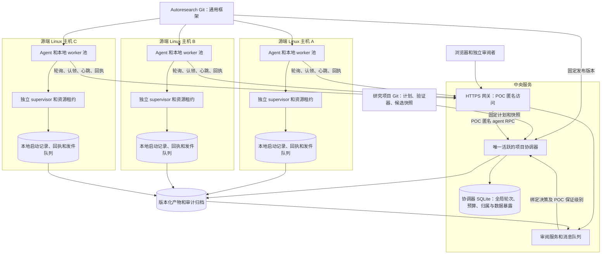
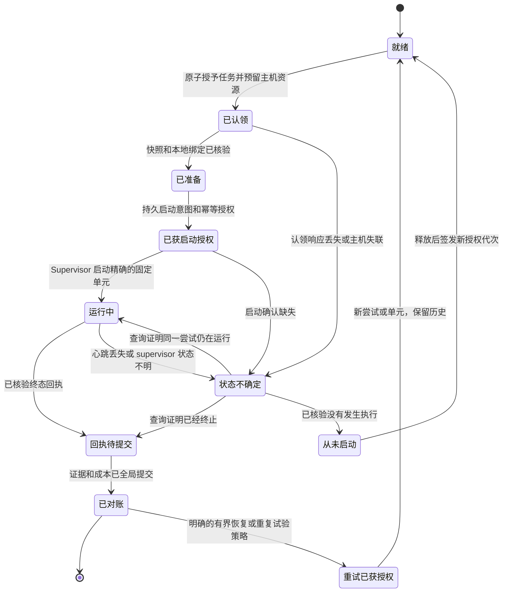
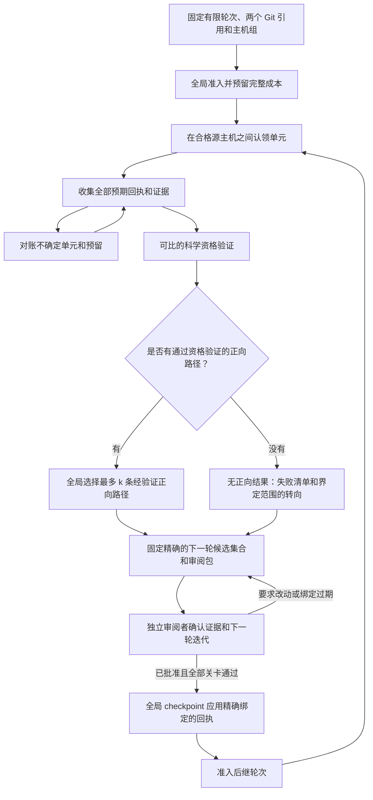
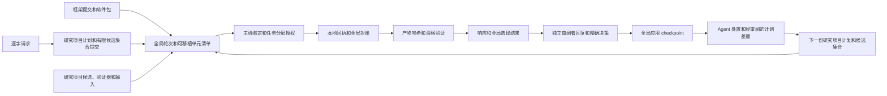
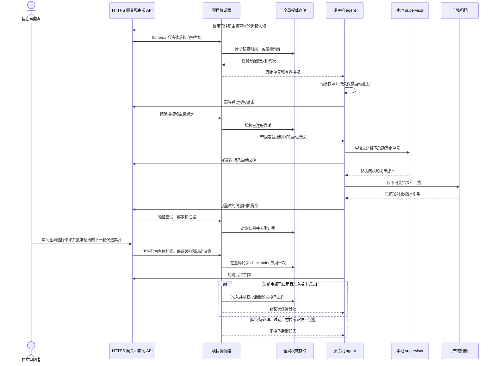
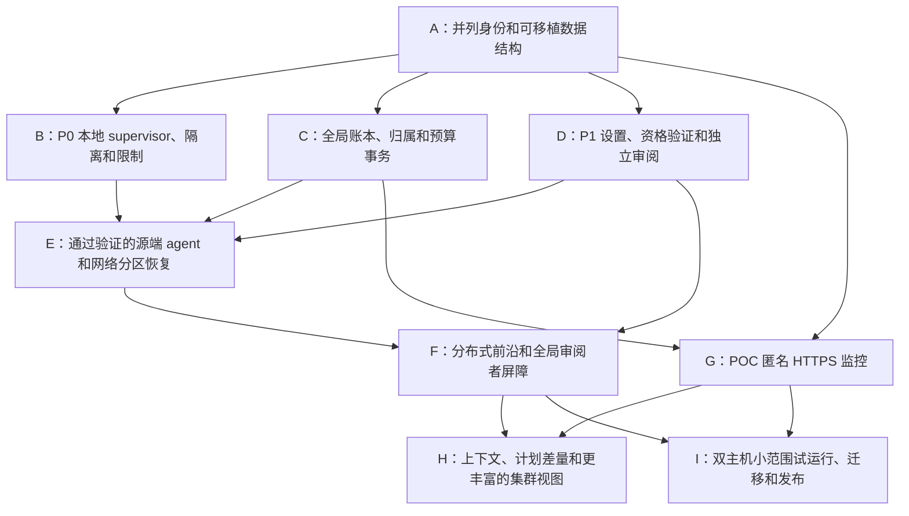

# 计划：分布式候选评估与可审计的 HTTPS 审阅

创建时间：2026-10-28T12:05:36-07:00
刷新时间：2026-10-28T19:31:56-07:00
状态：提案；尚未实施或部署。
框架基线：`hotneutron/autoresearch` 的 master，提交 `33ef750face59b42f9663c8e355a77600d1765e7`，可选 runtime `0.5.8`。
设计输入：[1503 采用评估](261028-1503-fork-feature-adoption-priorities.md)，SHA-256 `e86122cfdee72ba842a856f634940fb5f6f8d6ff37ef711067272aed222cf2dc`。
目标：一个研究项目协调器、多台源端 Linux 主机，以及 POC 阶段匿名开放的 HTTPS 审阅/集成 API。

## 用户提示：逐字保留原文，并附中文译文

```text
write a plan to use a server to host the review dashboard, instead of the local 127.0.0.1 server.
```

译文：编写一份计划，使用服务器托管审阅看板，替代本地的 127.0.0.1 服务器。

```text
an https server, not necessarily internal.
```

译文：使用 HTTPS 服务器，不一定是内部服务器。

```text
differentiate the experiment plans, execution, artifacts, responses and replies into reasonable persistent/sharable storage (git, local, remote) for an auditable flow.
```

译文：合理区分实验计划、执行、产物、响应和回复的持久化及共享存储位置（Git、本地、远程），形成可审计的流程。

```text
consider the autoresearch checkout will be the subject project's peer checkout, please be clear about autoresearch's git and the subject project's git. 
also, brainstorm a method to enable parallel search paradigm (evaluation many hypothesis at the same time, then select top-k paths with validated positive outcomes, with the confirmation of an independent reviewer for the next iteration).
please balance the git branching cost and the search parallelization.
then refresh the planning doc from scratch instead of patching it while keep the revision history.
```

译文：考虑到 autoresearch 的检出目录将与研究项目的检出目录并列，请明确区分 autoresearch 的 Git 与研究项目的 Git。另外，构思一种支持并行搜索的方法：同时评估多个假设，然后从得到经验证正向结果的路径中选择 top-k，并由独立审阅者确认下一轮迭代。请平衡 Git 分支成本与搜索并行度。随后从头重写计划文档，而不是局部修补，同时保留修订历史。

```text
given the 1503 doc, refresh the .plan/261028-1205-host-review-dashboard-over-https.md from scratch again.
```

译文：根据 1503 文档，再次从头刷新 .plan/261028-1205-host-review-dashboard-over-https.md。

```text
add enough mermaid to the 1205 plan to improve readability.
```

译文：为 1205 计划加入足够的 Mermaid 图，改善可读性。

```text
can we leverage multiple 'source linux host' to make the autoresearch distributed?
```

译文：能否利用多台“源端 Linux 主机”，让 autoresearch 支持分布式运行？

```text
refresh the 1205 from scratch again for the distributed candidate eval.
```

译文：面向分布式候选评估，再次从头刷新 1205 计划。

```text
allow https anonymous API/evidence reads and writes for now (POC phase).
```

译文：POC 阶段暂时允许匿名 HTTPS API/证据读取和写入。

## 预期结果与范围

将有限假设集合分配到多台 Linux 主机。
每台主机运行固定版本的 autoresearch 安装，其检出目录与研究项目检出目录并列；
在本地监督下执行获分配的不可变单元，并发布回执和证据。
一个项目协调器负责准入、全局轮次屏障、资格验证/选择、预算，
以及独立审阅者决策的应用。

全局最多保留 k 条经验证的正向路径；
之后必须由独立审阅者批准精确的后继候选集合，任何主机才能开始该轮迭代。
审阅看板托管在公网或私有网络的 HTTPS URL；POC 默认采用 `anonymous_poc`，匿名开放 API/证据读取和写入。
计划、候选谱系、产物、响应/回复和已应用决策，
在跨主机、跨两个 Git 仓库的流程中都保持可审计。

这是分布式候选搜索。
候选单元可以是独立进程，也可以是通过验证的容器作业。
单个候选的多节点训练是另一项执行器能力。
首个分布式版本使用已注册、自有的 Linux 主机和出站 HTTPS agent；
额外云厂商适配器仍属于后续工作。

[1503 优先级](261028-1503-fork-feature-adoption-priorities.md#prioritized-adoption-matrix)
继续提供机制选择：codex/pi 固定设置、FAROS/EvoMap 审阅绑定、
MLX/AutoKernel 资格验证、evo 前沿/工作区池/bundle 模式，
以及 P2 上下文/计划反馈。
最新请求将自有主机的分布式适配器纳入核心执行路线，
在 P0/P1 关卡之后、可选 P2 完善和 P3 provider/平台扩展之前实施。
[1147 安全计划](261028-1147-todo-with-priority.md) 仍是前置条件。

## 主机集群架构与权威归属

控制平面与审阅服务可以共用服务器，但使用不同角色和进程运行。
全局权威位于协调器 API 后；审阅镜像展示记录并将消息排队。
每个源端 agent 主动发起出站 HTTPS 调用，
并在本地执行协调器签发的任务分配及业务关卡。
POC 调用者身份为自行声明；身份认证放在后续访问配置中。



| 组件 | 权威与职责 |
|---|---|
| 项目协调器 | 固定可移植契约和轮次；准入聚合成本；授予工作；对账预期单元；验证资格/排序；应用审阅者决策并准入后继轮次。 |
| 全局元数据存储 | 由协调器持有的 SQLite，以事务管理轮次/单元/尝试归属、全局预算/容量、审阅应用、确认数据暴露、发件队列/事件和历史导入。 |
| 源端执行 agent | 公布已注册容量/配置，准备快照，持久保存启动意图，取得启动授权，监督分配的工作，并重试投递回执。它不能自行准入搜索轮次。 |
| 本地 supervisor/执行器 | 即使 agent 或协调器消失，仍负责进程/容器身份、硬性截止时间、取消，以及本地 CPU/GPU 租约。 |
| 审阅服务 | 提供 POC 匿名报告/证据读取、已声明写入、回复和审阅队列。镜像记录决策，协调器通过全局关卡应用决策。 |
| 产物归档 | 不可变/版本化的候选对象、清单、选定输出、回执、审阅/消息载荷，以及封存审计片段。 |
| 研究项目晋级写入方 | 一个指定写入方，在全局审阅关卡通过后更新保留的共享研究项目分支和集成提案。 |

首个分布式发布默认使用 SQLite 作为全局元数据存储。
唯一的权威 `coordinator.sqlite3` 位于协调器服务器的持久本地磁盘或块卷上，
每个研究项目只有一个活跃协调器，全局写入由协调器负责。
主机 agent 通过 POC 匿名 HTTPS API 访问全局状态。
主机本地恢复/发件队列和审阅镜像可以保留各自独立的 SQLite 文件。

### SQLite 事务与持久性策略

需要全局原子性的轮次/单元归属、预算预留/计费、审阅应用、
确认数据暴露及其事务型发件队列，应放在同一个协调器数据库中。
独立的审阅/主机存储通过幂等事件交换数据；
WAL 事务不能保证多个独立数据库文件整体原子提交。

启用 WAL、`synchronous=FULL`、`foreign_keys=ON` 和有界
`busy_timeout`（初始值 5000 ms）。
认领、预算变更、暴露预留和审阅应用使用短 `BEGIN IMMEDIATE` 事务，
配合唯一性约束和条件更新，在写事务内重新核对当前绑定，提交后才确认成功。
产物传输/哈希计算、远程调用和实验执行都在写事务之外完成。

SQLite 串行处理写入，WAL 允许并发读取。
所有访问权威文件的数据库连接都位于协调器主机上，并使用可靠的本地锁；
源端 agent 不得通过 NFS 或其他共享网络文件系统挂载该文件。
写队列/锁等待、长时间读取和 WAL 增长均须有界且可观测。
锁等待超时、磁盘满或提交 I/O 错误返回可重试/错误结果，
不得误报已授予工作或已应用决策；重试保留请求 ID 和代次。
大型 trace/模型保留在归档中，SQLite 只保存有界元数据及引用。
使用在线备份 API，恢复后完成验证和对账，再允许准入。

该方案支持协调器在其权威磁盘上重启恢复，不提供自动跨服务器数据库故障切换。
只有需要不同服务器上的独立协调器写入、数据库高可用，
或短事务优化后仍有持续且已测得的写争用时，才重新评估 PostgreSQL。
增加源端执行主机本身不要求更换数据库。
生产准入需针对 SQLite 的实际事务、崩溃和并发行为完成验证。

## 并列检出目录与 Git 归属

每台源主机配置独立根目录：

```text
<workspace>/autoresearch/    # 框架 Git 和通过验证的安装源码
<workspace>/<subject>/      # 研究项目 Git 镜像 / 项目适配器
<durable-run-root>/          # 本地启动记录、回执、租约和发件队列
<workspace-pool>/            # 活跃单元使用的可丢弃研究项目快照
```

两个检出目录之间不存在隐含的子模块关系。
显式配置 `framework_root`、`subject_root`、项目/仓库身份、
本地数据/缓存根目录，以及协调器端点。
从 autoresearch 目录启动 agent，不能将该目录选为研究项目源码/证据根目录。
改动之前，阅读每个检出目录适用的规则。

| 材料 | Autoresearch Git | 研究项目 Git | 外部持久化 |
|---|---|---|---|
| 协调器/agent/执行器协议、数据结构、身份认证、界面 | 负责可复用实现、测试、部署示例和本计划。 | 固定所采用的兼容框架。 | 已安装软件包/镜像身份。 |
| 目标、实验计划、有限候选集合、科学指标/保护检查/资格验证 | 仅定义数据结构/编译器。 | 负责撰写定义和精确的经审阅提交。 | 固定的可移植契约和计划快照。 |
| 项目适配器、验证器和候选代码/配置 | 接口和可复用测试样例。 | 负责代码和全部候选对象/保留引用。 | 可恢复的候选 bundle 和配置清单。 |
| 运行、预算、主张、回复和回执 | 仅负责通用验证/传输。 | 简洁的已接受结论和清单引用。 | 全局数据库、本地账本和归档。 |
| 凭据和大体量产物 | 仅保存模板。 | 仅保存模板或简洁引用。 | 受管理凭据、获授权注册表和版本化数据对象。 |

每个执行单元绑定 `framework_ref`（仓库/完整提交、wheel/镜像摘要和协议版本）
与 `subject_ref`（仓库、计划提交/路径/哈希、基线、候选代码树/配置、
适配器/验证器/输入身份）。
主机环境和硬件绑定是额外证据。
框架升级提交框架 PR；科学研究改动提交研究项目 PR。
不得在活跃的固定运行环境中重新安装框架。

搜索路径、Git 分支、报告系列 `branch` 和主机 ID 属于独立命名空间。
每台主机的私有候选引用不会创建共享研究分支。
所有公开的研究项目路径晋级由一个写入方负责；
整个项目前沿最多有 k 个活跃保留路径分支，
再加一个可选的 campaign 文档分支。

## 可移植契约与分布式状态

绝对路径、本地 PID，或复制的节点本地目标账本，
都不能定义面向整个主机集群的准入。
新契约可移植、按内容寻址，并使用逻辑研究项目/输入/输出根目录。
执行之前，每台主机验证并记录不可变本地绑定，
包括展开后的 argv、解析后的挂载、可执行文件/环境闭包和本地输出路径。
仅允许在固定的配置范围内重新绑定。

| 记录 | 必须具备的身份/绑定 |
|---|---|
| `ExperimentSpec` | 逐字指令、两个 Git 引用、允许修改的范围、评估器/指标/保护检查、基线/输入版本、比较协议和支持的成本维度。 |
| `RoundPlan` | 项目/目标/上下文、唯一轮次和父路径、完整候选/任务图、N/C_global/k、资格验证/确认，以及完整路线的最高成本。 |
| `HostRegistration` | 已注册主机 ID/启动标签、agent/协议和能力/资源配置；POC 调用者自行声明身份，认证配置核验身份。 |
| `UnitSpec` | 全局唯一的候选/单元/阶段/重复试验 ID、可移植契约哈希、预期快照/输入/评估器、合格配置、前置依赖，以及有界资源/截止时间。 |
| `AssignmentGrant` | 单元/尝试 ID、获分配的主机/启动身份、代次/nonce、启动窗口、硬性执行截止时间，以及资源/预算预留。 |
| `HostBinding` | 可移植契约哈希、主机身份、解析后的根目录/argv、本地闭包/配置和 supervisor 作业身份。 |
| `ExecutionReceipt` | 单元/尝试/授权和主机绑定、实际终态/成本、进程/容器身份、输出/证据版本/哈希和生产者序号。 |
| `SelectionRecord` | 完整轮次清单、通过资格验证的正向结果、排除项、比较器/cohort/多样性、最多 k 条所选路径和证据哈希。 |
| `ReviewReceipt` | 精确的轮次/选择/报告/证据/下一轮集合哈希、两个 Git 引用及允许范围/预算；POC 行为主体标签可选且自行声明，并记录身份保证级别。 |
| `PlanDelta` | 有证据支持的变更前后字段、继承条件、预期效果、内容哈希，以及后继研究项目计划/范围。 |

全局 ID 在重试中保持稳定；`attempt_id` 记录一次独立的物理执行尝试。
执行、证据有效性、科学结果、审阅者决策、投递和归档持久性是独立状态。
迟到/过期尝试的回执仍是审计证据和成本记录，但不能覆盖当前权威结果。
生产者序号和规范哈希用于处理重复或乱序投递。

协调器的领导任期（leadership epoch）阻止旧协调器写入。
每次尝试的代次令牌阻止过期单元更新。
二者不同：领导者重启，不会仅因活跃授权由上一任领导者签发，就抹除该授权或使其失效。
新任协调器从数据库恢复真实归属。

## 准入、认领、监督与故障处理

P0 修复仍然是强制前置条件：
只有正常完成才接纳为科学有效、独立孤儿进程监督、严格资源/成本上限、
只读源码/输入挂载、受控执行身份，以及通过验证的取消机制。
当前代码采用本地/串行模式，拒绝未经验证的非本地后端，
并将目标准入绑定到本地目录。
旧有目标转向选择一个候选，且依赖本地路径。
保留该模式，同时增加显式分布式轮次/前沿数据结构，支持最多 k 条所选路径。
使用版本化协调器/agent 适配器，不得绕过已有检查。

用一个原子事务准入完整全局轮次，并预留最坏情况成本，
包括主机基线、全部已声明资格验证、必要确认、
启动/编译/关闭、失败和后续工作。
成本按回执身份去重；未解决尝试保留保守预留。
支持的成本维度和费率必须明确。
并行加速不能减少聚合计算计费。

只有满足以下条件才授予工作：
经审阅轮次已准入、单元前置依赖通过、没有全局暂停、
主机/配置合格、满足全局 C_global 和主机 C_host/资源限制，
且该逻辑单元不存在未解决的活跃尝试。
主机本地资源获取是第二层检查。
准备失败时返回绑定到该任务的“从未启动”回执，
不允许主机因此挑选其他未获授权工作。

先持久保存本地启动意图，
再为该精确授权取得幂等的全局启动授权，然后通过独立 supervisor 启动。
响应丢失时，用相同请求/nonce 重试。
Supervisor 负责稳定作业身份、截止时间和本地租约；
查询/取消/回执获取始终独立于提案 agent 可用。
检查主机时钟；在固定的获授权时长/启动窗口内，
本地超时执行使用单调时钟。

下列状态机将通信缺失视为执行状态的不确定性。



心跳/认领租约过期会改变对调度状态的判断，
但不能证明进程已经停止。
代次令牌会拒绝过期更新，却不会终止 GPU 作业。
重新分配之前，必须取得已核验的取消/终态，
或可信的“从未启动”证据。
记录的截止时间已过，也必须核验 supervisor/主机状态，不能盲目重放。
状态不明单元保持对账中，不能通过资格验证，也不能提前释放未解决预留。

| 故障 | 必须采取的行为 |
|---|---|
| 协调器不可用 | 主机只完成已获授权的有界工作，并保留发件队列。新认领/轮次准入等待。重启时恢复已有授权，不重新复制作业。 |
| 子进程运行时 agent 崩溃 | 独立 supervisor 执行截止时间并负责租约/回执；替代 agent 查询同一作业身份。 |
| 网络分区或心跳丢失 | 将主机/单元标为状态不确定；必要时隔离新调度。不能仅因计时器过期，就重新分配不确定单元。 |
| 主机重启 | 核验启动身份改变及旧执行已终止；对账回执/成本，并依据明确策略授权恢复。 |
| 回执或上传确认丢失 | 使用相同 ID/哈希重试。载荷冲突则失败；重复投递不重复计费或应用。 |
| 恢复后旧尝试返回 | 保留迟到回执用于审计/成本；代次过期时，拒绝它更新权威状态/资格验证。 |
| 明确暂停/停止 | 全局阻止新认领/轮次。运行作业遵循已声明的有界排空/取消策略；网络分区中的节点仍受本地硬性截止时间约束。 |

传输可重试且幂等。
面对任意故障，不能将其视为物理执行恰好一次的保证。
物理重试/重复试验须单独授权，保留失败尝试成本/历史，并遵守确认数据暴露限制。
恢复还要求轮次尚未关闭，并符合已声明重试配额/预算。
关闭轮次不能重新打开；以后的验证需要新的、固定且经审阅的轮次。
有效的负向或无法下结论的科学结果，不能改标为流程失败。

## 全局资格验证、Top-k 与独立的下一轮迭代

准入前固定完整任务图和比较基础。
候选具有唯一阶段/重复试验身份；所有工作限定在经审阅任务图内。
默认预留完整资格验证预算。
可选初筛/跳过机制具有协议定义的状态和配额；
低成本初筛本身不能证明正向结果。

首次部署使用可比主机组：通过验证的硬件类别、数值精度、评估器、
输入/评估精度和框架兼容性。
在分配的主机上运行匹配的基线/候选对照，
并声明分组/随机分配规则和种子规则。
不能把硬件差异隐藏在一个全局分数里。
异构主机组需要分别报告分层结果/前沿，
或者使用明确验证的归一化/联合目标。
任何更广泛的迁移主张都需要跨主机确认测试支持。

必须记录显式种子/重复试验和全部样本。
1503 评估发现，MLX 辅助工具重复使用固定种子 42；
应实现真实种子控制，并准确标注固定种子的重复试验。
评估复用键包含两个仓库、完整候选/配置、输入/评估器、
环境/硬件、评估精度、种子和重复试验协议。
截短的代码哈希或噪声中的最高分都不够。

科学正向资格要求正常完成的有效执行、可比资格验证、
全部正确性/回归约束、已声明的最小有用效果，
以及不确定性/多重比较/自适应比较策略。
研究项目负责这些标准；框架检查其固定评估器/证据绑定。
LLM 评分、将平局计入多数支持，以及单纯指标改善，都不能绕过这些要求。

只有每个已准入的必需单元都已对账、通过资格验证、
明确无效/已取消，或属于协议定义的跳过状态时，才能封存轮次。
启动状态不确定会阻止封存。
选择使用完整已准入清单，只对经验证正向结果排序；
通过确定性同分处理和已声明多样性，全局最多保留 k 条路径。
完成时间绝不决定前沿。



审阅全局比较/选择和精确的下一轮候选集合，
包括被拒绝路径、剩余成本、两个 Git 引用、
证据/资格验证哈希，以及任何确认计划。
POC 的独立审阅依赖参与者遵守流程分工。
接受合法的匿名审阅决策，可附自行声明的行为主体/审阅者标签；
记录 `actor_assurance=poc_anonymous` 及其独立性说明。
其他关卡通过后，由协调器应用精确的证据/候选集合绑定。
界面将身份/独立性标为未核验；后续 authenticated 配置要求可信身份和作者/提案者分离。
模型别名仅为元数据。

全局 checkpoint 将应用提交一次，然后允许后继准入。
任何主机都不能自行推进路径，
也不能应用本地审阅者回复来创建另一轮。
代码/证据/配置/选择结果/父节点/候选集合/预算/范围变化，
会使相关批准失效。
审阅者可以批准更少的合格路径或要求证据；
最终应用的包绑定由此形成的精确提案。
零正向结果时不保留前沿，并生成重新界定范围、经独立审阅的转向。

### 全局确认数据暴露

审阅者确认是授权/评估；新的统计确认是证据采集。
为数据集摘要、科学研究总体/cohort 和 subject 身份维护一个全局暴露权威。
按科学研究总体划分命名空间，绝不按主机名或 Git 分支划分；
复制账本或重命名 campaign，不能让已暴露数据重新变为新数据。

在一次原子暴露预留之前，固定所有竞争候选快照、评估器、
联合分析/多重比较规则和成本。
将通过验证的批量评估委派给获批确认执行器；
仅发布允许的聚合结果。
每次打开，包括失败/中断的打开，都计为已消耗。
现有单候选 proxy 语义需要显式分布式/批量扩展和采用版本。
不得在多台主机上调用彼此独立的本地暴露账本副本。
必须准确记录标签访问隔离是依靠流程约束，还是由机制强制执行。

## 主机集群快照与有界研究项目 Git 分支

借鉴 [evo 工作区池租约](https://github.com/evo-hq/evo/blob/c70c04b4d2da2f2deb95d1d185b07d88d24f2ea7/plugins/evo/src/evo/backends/pool.py#L42)
和 [Git bundle 传输](https://github.com/evo-hq/evo/blob/c70c04b4d2da2f2deb95d1d185b07d88d24f2ea7/plugins/evo/src/evo/git_bundle.py#L34)
作为机制参考，并采用本计划的全局权威和审阅关卡。
候选生成和评估器代码归研究项目 Git。
框架 Git 只接收通用协议/agent 改动。


仅配置变化的试验共享固定源码快照，并各有独立清单。
修改代码的试验使用干净的分离 HEAD 提交，
包含新增文件/文件模式和固定闭包。
传输固定的 Git bundle 或同等经过验证的快照；
不要为每台主机/每个候选推送一个公开分支。
保持私有对象可达，直到已核验归档包含其基线前置对象和候选代码树。

每台主机落盘的评估工作区数量受 C_host 限制，
另加已声明准备/审阅容量。
复用前对账并释放此前槽位的全部归属。
源码/输入挂载保持只读；输出和可写缓存限定在单元范围内。
Worktree 提供源码隔离，经过验证的执行器提供操作系统隔离。

晋级写入方依据预期的先前引用推进保留的研究项目谱系；
并发的人类 Git 改动需要对账。
退役/落选路径仍可从归档恢复。
配置谱系可以继续用清单 ID 表示。
集成改变已评估代码树时，需要新的验证和适用审阅。
共享分支数在全局受 k 加一个可选 campaign 分支的上限约束，
不是每台主机各有 k 个。

示例：N=24，四台主机各 C_host=2，C_global=8，k=3，
在可比资源下进行三波评估，之后是资格验证和一个全局审阅包。
可以有 24 个归档候选对象，但最多只有三个保留的共享路径分支，
再加一个 campaign 分支。
无论实际耗时加速多少，聚合计算成本仍包含每个单元、基线、失败和确认。

## 持久化、响应、回复与审计来源

| 记录 | 权威持久化 | 可共享形式 / Git 归属 |
|---|---|---|
| 框架实现/协议 | Autoresearch Git 和经过验证的发布元数据。 | 固定框架提交/软件包。 |
| 科学目标/计划/候选集合/验证器和已接受修订 | 研究项目 Git。 | 精确计划/代码快照和少量清单/结果摘要。 |
| 全局轮次、预算、分配、审阅者应用和数据暴露 | 位于持久本地存储的协调器 SQLite。 | 封存的规范事件/清单导出；API 视图。 |
| 本地启动、进程身份、终态结果和重试 | 主机本地持久账本和 supervisor。 | 关联全局尝试的主机报告回执/发件队列及访问配置保证级别。 |
| 候选代码/配置及原始/选定输出 | 活跃期间保存在研究项目对象和源端运行目录中。 | 带键/版本/哈希和访问类别的版本化归档。 |
| 已发布证据/科学响应 | 根据预期全局单元验证的规范源端/评估器记录。 | 不可变报告/证据和公开响应记录。 |
| 人类提示/回复/审阅者决策 | 接受时进入 POC 匿名审阅队列；决策应用时进入全局账本。 | 不可变文本、回复父节点关系、自报标签/保证级别和决策/checkpoint 回执。 |
| Agent 确认收到/采纳/延后/拒绝响应 | 原始公开消息/steering 记录。 | 关联的全局 checkpoint、下一份计划差量和研究项目提交。 |
| 临时文件和未发送草稿 | 可丢弃本地工作区/浏览器内存。 | 只有升级为已接受消息/产物时才持久化。 |



每个事件记录全局 ID、适用时的主机/启动/尝试身份、
持久生产者序号、行为主体标签和访问/身份保证级别、发生/接收时间、
因果父节点、不可变载荷/哈希和可见性。
消息具有 `conversation_id`/`in_reply_to`；
编辑/取消通过追加替代记录处理。
投递状态行是事件投影。
保留实际公开响应和公开理由，
与原始执行输出及测量支持分开。
披露历史中缺失的行为主体/父节点/时间。

分别保留本地持久化、服务器已提交和归档已核验状态。
幂等提交回执/预算；证据资格验证之前核验被引用数据对象。
归档确认与 HTTP 消息接受是不同记录。
稳定的产物键/版本/哈希身份为已发布 POC 证据解析匿名 HTTPS 下载链接；
会过期的 URL 只是投递链接。
私有输入/标签保留在获授权注册表/执行器存储；
仅归档获批发布内容，以及采取适当访问限制的原始数据。

联邦汇集旧有记录时，使用外层项目/源端命名空间，
同时保留原始规范 ID/字节/哈希。
主机 A 的旧报告 ID 不能与主机 B 正文不同的报告发生冲突。
新的分布式 ID 全局签发；
工作流链接通过已注册来源和预期轮次/单元解析。
不要仅为增加主机名就重写旧数据包。

初始保留策略：已结束任务的临时文件保留七天；
已归档的本地工作区，在远程持久化已核验，
且不存在活跃租约/对账/发件队列或固定环境依赖后保留三十天；
计划/清单/回执/被引用证据和已接受消息历史，
保留项目生命周期加一年。
被引用日志遵循证据保留期限。
提供经过访问权限过滤、可用哈希核验、不依赖在线看板的离线审计包，
明确披露省略/缺失的受限输入。

## HTTPS API 与全局决策投递

### POC 访问配置

POC 默认采用 `access_mode=anonymous_poc`。
HTTPS 使用有效服务器证书并配置续期；全部已声明的公共 API/证据读写
无需登录、cookie、API key、Bearer 凭据、mTLS 客户端证书、已认证角色或
`X-Review-Token`。主机/源端集成 API 同样无需调用者凭据。
匿名读写都不要求客户端认证；现有 loopback 请求令牌策略不是 HTTPS POC 的访问策略。

| POC 接口 | 匿名行为 |
|---|---|
| 看板、报告/历史/实验 API、已发布证据/下载 | 公开 GET/读取。 |
| 报告/证据发布及版本化上传 | 接受符合 schema 的写入，核验哈希/上限；不可变 ID 冲突失败。 |
| 提示/回复、审阅决策及已支持控制操作 | 接受合法匿名写入，记录可选行为主体标签和 POC 保证级别。 |
| 主机注册/容量、认领/启动、心跳/查询/取消、回执/事件提交 | 接受合法匿名集成操作，仍需项目/单元/授权/代次等协议字段。 |

Schema、不可变内容 ID、可移植契约绑定、幂等性、预算/资源/暴露上限
及全局轮次/审阅应用继续作为业务校验。
任务授权的 nonce/代次用于关联执行状态，不是客户端登录凭据。
不能仅因调用者没有身份/角色证明、cookie 或请求令牌而拒绝 POC 写入。
未支持方法、非法/过期/冲突变更保持正常错误语义。

已声明 API/证据路由支持无凭据 CORS/OPTIONS，采用
`Access-Control-Allow-Origin: *`、各路由支持的方法/请求头，且不依赖凭据 cookie。
CLI 可省略 Origin；其他 origin 的浏览器调用者可使用 POC API。
前端/源端 SDK 根据访问配置，在此模式省略登录/CSRF/令牌前置要求。

记录匿名/自报的调用者、审阅者和主机保证级别，准确标注未核验的作者身份/独立性。
协调器仍负责分配、资格验证和后继应用；符合绑定的匿名审阅决策
可在其他关卡通过后推进候选集合。已发布 POC 证据通过 HTTPS 公开。
未发布私有输入、数据库文件、标签和存储服务凭据保持既有非公开存储位置；
后端可通过匿名证据 API 代理归档访问。

### POC 后的认证配置

后续可选择 `access_mode=authenticated`，增加 OIDC 查看者/审阅者权限、
可信行为主体/源端身份、限定项目/主机的凭据、已核验的审阅者/作者分离，
以及浏览器 origin/请求保护。配置外部 Host 路由并剥离不可信身份头；
调用者提供的角色标签不是证明。POC 就绪关卡不依赖此配置的部署。
1503 的借鉴身份认证模式用于这一后续配置。

拟议的集成操作包括注册/容量、认领、准备/启动授权、
心跳/查询、取消确认、终态回执/产物提交和事件发布。
浏览器审阅提交回复和精确绑定的决策。
协调器根据全局账本和固定可移植契约验证全部操作。
这些 API/CLI 操作是设计目标，不是当前已支持的命令。



限制正文大小、分页/游标、请求截止时间、并发、
重试退避和源端发件队列容量。
规范导入保留报告哈希/时间，并解析证据/工作流依赖；
绝不能将源端路径解释为服务器上可任意读取的文件系统路径。
使用安全的不透明归档引用，替代对远程绝对路径的假设。

分别显示浏览器刷新、源端心跳/观察距今时间、
执行状态和科学报告发布时间。
初期每五秒心跳/同步，三十秒后在展示中标为过期，并检查时钟偏差。
该展示阈值不是重新分配超时。
主机离线时历史证据仍可读；
全局状态不确定时，阻止轮次完成/推进。
保留所有候选结果、两个语言版本、固定修订和每个数据包的草稿。

## 采用优先级与实施依赖

保留 1503 的借鉴边界，同时将已注册主机适配器作为分布式核心的一部分。
可选训练平台移植、云厂商 SDK 和多节点训练能力，
仍属于以后由研究项目推动的工作。



| 工作包 | 框架 Git 交付内容 | 研究项目 Git/配置交付内容 | 验收关卡 |
|---|---|---|---|
| A — 归属/可移植数据结构 | 双仓库身份、可移植单元、主机绑定和版本化采用契约。 | 科学目标、源端根目录/规则、输入、适配器/验证器和比较主机组。 | 同一单元能在两个不同根路径下正确落地，而不改变规范身份。 |
| B — P0 源端执行 | 仅正常完成才接纳、独立 supervisor、硬性截止时间/上限、通过验证的配置和本地租约检查。 | 声明资源类别/执行配置和有界测试样例。 | Worker/agent 丢失和 TERM 后零退出码，都不能产生假正向证据或无界作业。 |
| C — 全局权威 | SQLite 轮次/预算/暴露存储及事务型发件队列、单元归属、领导任期、尝试代次、幂等成本/事件和有界短写事务。 | 范围/费率、历史计费来源和全局资源策略。 | 并发认领不能重复创建活跃单元或超出全局/本地上限；重启保留真实授权。 |
| D — P1 科学/审阅契约 | ExperimentSpec、有限数值输出/保护、资格验证、绑定证据的审阅/全局应用及 POC 保证级别；身份认证为后续配置。 | 正向效果/统计/种子、确认及流程审阅策略。 | 无效证据/过期集合不能推进；合法匿名审阅可用，并准确显示身份保证级别。 |
| E — 自有主机适配器 | POC 匿名出站认领/启动/查询/取消/回执 API 和节点守护进程；后续提供认证配置。 | 注册主机/启动/配置/数据标签和兼容性。 | 无凭据合法调用可用；确认丢失/分区得到对账，心跳过期不盲目重复工作。 |
| F — 分布式搜索/Git | 全局有限任务图、资源调度、屏障、通过资格验证的 top-k、快照注册表/工作区池和一个晋级写入方。 | 假设、候选差量、多样性/排序、有限后继候选集合，以及保留分支约定。 | N/C_global/C_host/k 在全局成立；下一轮迭代要求已应用一次独立审阅。 |
| G — HTTPS/审计路线 | POC 匿名 API/证据读写、集群视图、规范导入、审计/传输和共享导出。 | 已发布证据策略、源端适配器和身份保证级别。 | 公开读写、跨 origin 和 CLI 流程可用，主机失联期间状态/历史仍准确。 |
| H — P2 学习/产品 | 规范恢复上下文包、有证据支持的失败重访、带类型的 PlanDelta/条件、可选 hook/能力配置和更丰富的前沿/回复视图。 | 已接受科学修订和简洁结论。 | 已接受回复成为可追溯的新研究项目计划/契约，不悄悄修改运行单元。 |
| I — 切换/发布 | 存储/适配器一致性、Linux/干净 wheel 回归、迁移/恢复文档和兼容软件包。 | 双主机受控小范围试运行、已对账的旧有范围/成本和采用版本。 | 分布式搜索、故障恢复、审阅者/暴露关卡和归档恢复一起通过。 |

实际分布式派发等待 B/C/D/E 完成。
G 联邦监控可以更早通过已注册的旧有发布者推进；
其投影视图不会创建共享搜索准入。
首个完整发布要求 F 和 G；可选 H 功能可以后续加入，
不必延迟已经通过验证的自有主机分布式能力。

复用/适配 [codex 设置](https://github.com/leo-lilinxiao/codex-autoresearch/blob/0f54c571707487f59486ba7c50d405edfc746c19/scripts/autoresearch_core.py#L238)、
[FAROS 签核](https://github.com/OpenNSWM-Lab/FAROS/blob/60ce4bc235f169d71f2d11dbe37445b4e402b528/backend/app/modules/review/reviews_api.py#L1943)、
[EvoMap 回执绑定](https://github.com/EvoMap/AutoResearch/blob/21f591298aca78690722686c38984ac2b7d6f7e6/ar-runtime/scripts/ar-workflow-engine.py#L1658)、
[MLX 资格验证概念](https://github.com/trevin-creator/autoresearch-mlx/blob/766a25ff22afa799efd8d0aa450a4348e4749df2/rigor.py#L79)、
[AutoKernel 正确性](https://github.com/RightNow-AI/autokernel/blob/78435821cc3d5756ba6ee1785c397f6d8fa8c90d/bench.py#L641)
和 evo 工作区池/前沿/bundle 机制。
不要移植无人值守继续、仅按代码去重、借鉴项目专属模型评分、
默认可写的固定源码，或未经验证的远程 shell 接口。

可能新增的框架文件有 `portable_contract.py`、`control_plane.py`、
`global_store.py`、`host_agent.py`、执行器/supervisor 适配器、
`qualification.py`、`search.py`、`snapshots.py`、
`review_policy.py`、`audit.py`、`sync.py` 和部署配置。
现有 controller/worker/goal/confirmation/protocol/界面模块，
需要显式版本化集成。
保留旧有单主机 campaign 行为和已存身份；
源端与全局存储使用不同数据结构，不是共享文件。

## 验证、迁移与恢复

- **SQLite 权威存储：**并发认领、预算预留、审阅应用及暴露写入，
  核对唯一性、外键、条件更新和整体事务回滚。
  注入 `SQLITE_BUSY`、磁盘满/提交失败、长时间读取、检查点/重启及在线备份/恢复。
  提交失败不能确认工作授权、重复计费或决策应用；恢复后的授权必须对账。

- **可移植归属：**两台检出/挂载路径不同的主机，绑定同一个框架/研究项目/输入/评估器契约。
  拒绝错误根目录、源码漂移、不兼容配置和无效逻辑路径；合法 POC 调用不要求主机凭据。
- **全局准入：**对 C_global+1 个认领和重复启动请求进行竞争测试，
  包括跨主机的相同单元。
  核验唯一活跃归属、预留保留、精确计费、旧领导者隔离，
  以及协调器重启后已注册授权仍有效。
- **源端生命周期：**在每个启动阶段终止 agent/worker/协调器；
  核验独立硬性截止时间、进程/容器查询、本地租约和有效回执。
  测试配合处理 TERM 后零退出码，以及派生子进程清理。
  不得假设租约过期会终止执行，或能证明物理作业恰好执行一次。
- **网络分区恢复：**在认领/启动/回执之后切断 HTTP；
  延迟或过期代次不能覆盖结果，也不能触发并发重放。
  核验从未启动和已取消状态证明、明确恢复预算和迟到成本。
- **科学比较：**匹配主机基线、显式种子/重复试验、
  留出/资格验证范围、硬件分层和多重比较策略。
  使用已知正向/负向/含噪声测试样例，确立全局资格和最多 k 条路径。
- **全局审阅/暴露：**合法匿名 POC 审阅写入成功，并显示自报/未核验身份；
  过期/无效/错误轮次决策失败。认证配置另行测试伪造身份和自审拒绝。
  全局应用之前，任何主机不得推进。
  并发确认请求不能通过改变主机/分支/campaign 名称重新打开 cohort/subject；
  失败打开也计入暴露。
- **Git/归档/审计：**四台 C_host=2 的源主机运行 N=24/C_global=8/k=3；
  共享研究项目分支最多四个、工作区有界，并可恢复落选快照。
  从两个 Git 引用追踪到主机绑定、回执、证据、响应/审阅者回复、
  全局 checkpoint 和后继。
  不完整/损坏事件及缺失数据对象明确失败。
- **HTTPS/界面：**无需 cookie、凭据或令牌即可匿名读写 API/证据，
  包括上传、审阅、集成和 CORS/OPTIONS；无效哈希/schema、不可变冲突及过期代次仍失败。
  认证配置的拒绝/角色/origin 校验单独测试。
  测试源端过期而浏览器正常、全局未完成轮次显示、
  历史版本绑定、完整候选/回复清单、两个语言版本、
  草稿保留和经过访问权限过滤的离线包。
- **回归：**运行适当的现有/新增源码测试、存储/适配器一致性测试、
  干净 wheel 测试，以及实际模板 JS 检查。
  执行集成在 Linux 上运行。
  这些是计划中的验收检查；不声称分布式实现已经存在。

分阶段切换：POC 匿名 HTTPS 读取和写入；
一台通过验证的源主机配合全局权威；
两台兼容主机加故障注入；
之后在经审阅资源范围内增加主机集群容量。
扩大规模前，核验一个候选的完整证据，
以及一份故意保持待处理、之后才应用的全局审阅者决策。

活跃旧有 campaign 继续使用其固定的本地 runtime。
采用新的分布式目标之前，对账其单元和范围。
导入历史成本/准入时保留原始身份/证据，并对重复导入去重；
不能重置既有计费，也不能推断未经证明的余额。
使用来源命名空间快照/导入规范的旧有审阅记录。
将全局账本初始化为空，
不构成对已有项目预算已耗尽或部分预留状态的有效延续。

将全局元数据/领导权/注册和数据暴露记录、审阅队列、
源端本地恢复/发件队列，以及被引用对象版本，
备份为一致的恢复目录。
活跃数据库使用 SQLite 在线备份 API，核验完整性和已提交事件游标，
并监控 WAL 检查点进度；直接复制活跃数据库主文件不能替代一致备份。
演练领导者重启、源主机重启、数据库恢复和回执重放。
分别监控 TLS/存储、主机容量/配置、时钟偏差、心跳距今时间、
supervisor 执行截止时间、待审阅/回执、
不确定预留和归档提交。
每日备份和记录恢复演练作为初始策略。

回滚时冻结新的全局准入和托管提交，
保留已接受队列/授权，
并在现有 supervisor 下排空或取消已经获授权的单元。
恢复或采用另一 runtime 之前，对账尝试/成本/数据暴露。
绝不能将恢复出的决策应用到已改变证据/候选集合，
释放状态不明的预留，或删除尚未得到确认的发件队列。
清理要求归档已核验，
且没有运行中/未解决/固定环境依赖。

## 实施输入与暂缓能力

确定研究项目仓库/规则和两个 Git 固定版本、可移植根目录映射、
科学资格验证/cohort/种子及确认定义、全局/本地容量和成本维度、
流程型 POC 审阅者/行为主体策略及未来已认证签发者策略、主机注册/监督、
协调器本地 SQLite 磁盘/事务/备份策略、TLS/匿名路由/CORS 及未来登录/角色范围、
数据/产物访问、保留策略、旧有预算/导入证据、
晋级写入方和运维归属。

P2 的上下文包保持客观、有界；
只有假设/证据变化时才重启失败方向；
获批且不绑定具体模型的 PlanDelta 转为研究项目 Git 修订和新的固定轮次。
预期效果仍与观察到的证明分开。
可选 hook 必须声明、预算化且仅作建议；
自动硬件适配发生在固定之前，不能悄悄改变运行单元。

训练平台移植、广泛的文献/论文流水线、借鉴项目专属模型评分、
额外云厂商 SDK，以及单个候选的分布式训练，
都是独立的后续能力。
macOS 训练移植不会使 Linux 监督自动具备可移植性；
硬件/attention 语义变化需要新的资格验证。
直接复用的借鉴代码保留署名/声明，
并准确说明流程信任和访问限制。

## Revision History

| 修订 | 时间戳 | 变更 |
|---|---|---|
| r1 | 2026-10-28T12:05:36-07:00 | 保留用户请求、`.plan/` 位置、托管方案及 HTTPS 澄清；基于 runtime 0.5.8 设计独立服务器方案，包含不可变数据同步、以源端为权威的反馈、经认证的托管、分阶段交付和恢复标准。 |
| r2 | 2026-10-28T12:14:12-07:00 | 保留存储/审计请求；为计划、执行、产物、响应、回复和处置分配 Git/本地/远程存储，增加运行清单、因果审计事件、保留/共享、归档持久性及端到端验证。 |
| r3 | 2026-10-28T14:48:11-07:00 | 从头重写文档，同时保留已有提示和历史；区分并列框架与研究项目的 Git 归属，设计基于快照探索、有独立审阅者关卡的有界并行束搜索，并整合存储、HTTPS 托管、实施依赖和验证。 |
| r4 | 2026-10-28T15:13:36-07:00 | 根据 1503 评估从头重建计划：按优先级关卡适配借鉴机制，明确并列 Git 归属、固定设置/审阅者/资格验证契约、有界前沿和快照、持久审计/HTTPS 投递、工作包及验收；增加六张 Mermaid 图，并保留此前提示和历史。 |
| r5 | 2026-10-28T15:41:07-07:00 | 面向分布式候选评估从头重写计划：统一的全局项目权威、可移植并列仓库契约、通过验证的主机 agent/本地 supervisor、事务型预算/归属/数据暴露、能安全处理网络分区的对账、全局 top-k/审阅者关卡、有界研究项目 Git 晋级、带命名空间的审计/HTTPS 投递，以及分阶段迁移；保留提示和 r1–r4，并增加七张 Mermaid 图。 |
| r6 | 2026-10-28T16:13:07-07:00 | 首个全局元数据后端改为由协调器持有的 SQLite；明确单主机权威、归属/预算/审阅/暴露/发件队列原子事务、WAL/完整持久性、有界争用和备份/恢复验证，仅在未来需求得到证实时再考虑 PostgreSQL。 |
| r7 | 2026-10-28T19:31:56-07:00 | 明确 anonymous_poc 阶段 HTTPS API/证据匿名读写，包括源端集成、无凭据 CORS 和审阅提交；记录自报/未核验身份保证级别，将已认证身份放在后续配置，并同步图示、工作包和验收检查。 |
