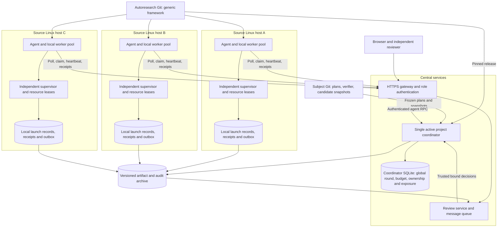
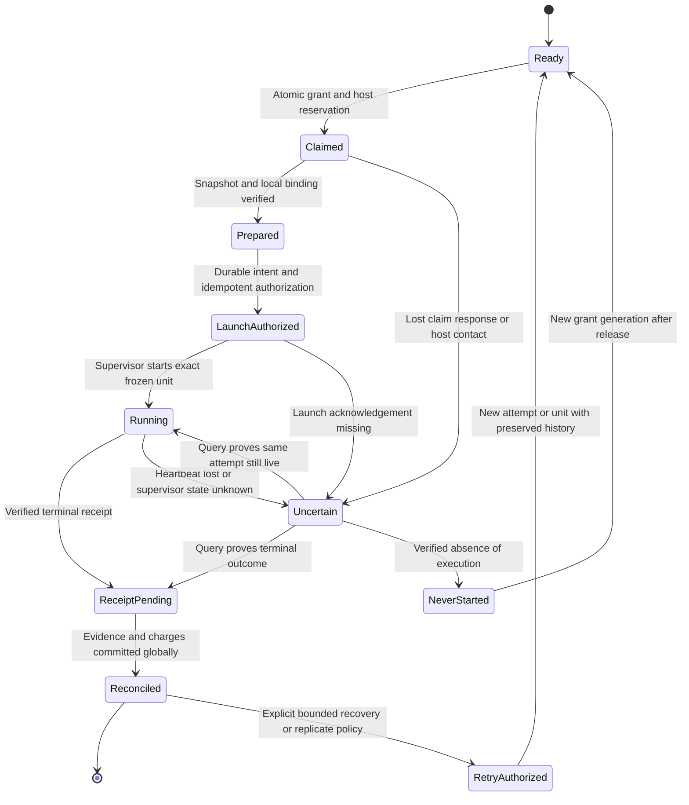
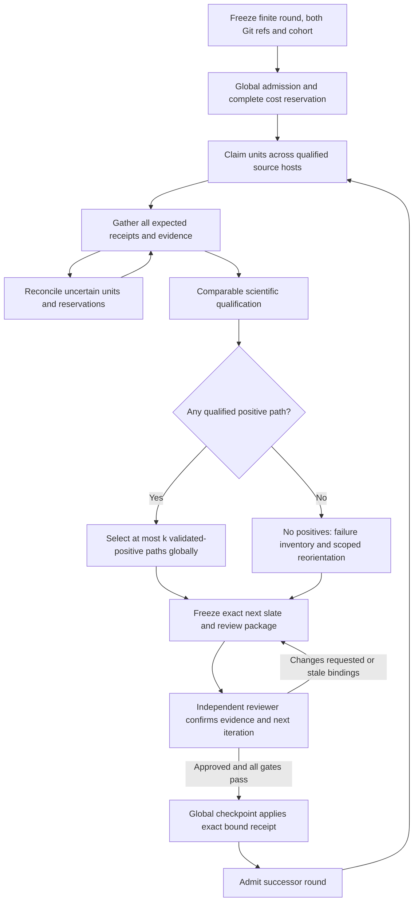
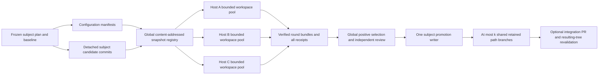
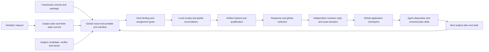
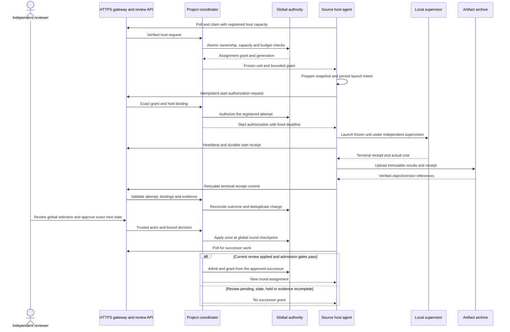
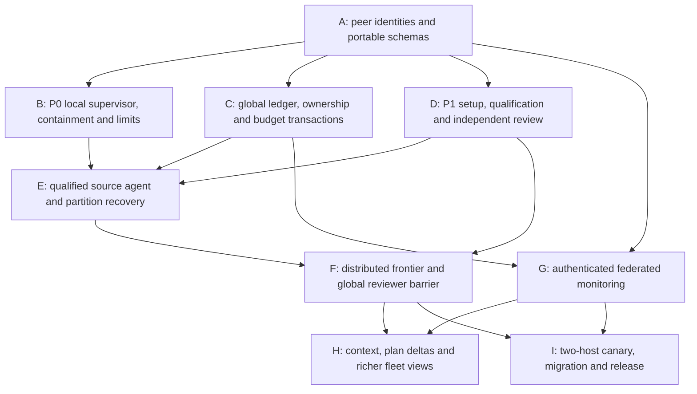

# Plan: Distributed Candidate Evaluation and Auditable HTTPS Review

Created: 2026-10-28T12:05:36-07:00
Refreshed: 2026-10-28T16:13:07-07:00
Status: proposed; implementation and deployment are pending.
Framework baseline: `hotneutron/autoresearch` master at `33ef750face59b42f9663c8e355a77600d1765e7`, optional runtime `0.5.8`.
Design input: [1503 adoption assessment](261028-1503-fork-feature-adoption-priorities.md), SHA-256 `e86122cfdee72ba842a856f634940fb5f6f8d6ff37ef711067272aed222cf2dc`.
Target: one subject-project coordinator, multiple source Linux hosts, and a separately authorized HTTPS review service.

## User Prompts, Verbatim

```text
write a plan to use a server to host the review dashboard, instead of the local 127.0.0.1 server.
```

```text
an https server, not necessarily internal.
```

```text
differentiate the experiment plans, execution, artifacts, responses and replies into reasonable persistent/sharable storage (git, local, remote) for an auditable flow.
```

```text
consider the autoresearch checkout will be the subject project's peer checkout, please be clear about autoresearch's git and the subject project's git. 
also, brainstorm a method to enable parallel search paradigm (evaluation many hypothesis at the same time, then select top-k paths with validated positive outcomes, with the confirmation of an independent reviewer for the next iteration).
please balance the git branching cost and the search parallelization.
then refresh the planning doc from scratch instead of patching it while keep the revision history.
```

```text
given the 1503 doc, refresh the .plan/261028-1205-host-review-dashboard-over-https.md from scratch again.
```

```text
add enough mermaid to the 1205 plan to improve readability.
```

```text
can we leverage multiple 'source linux host' to make the autoresearch distributed?
```

```text
refresh the 1205 from scratch again for the distributed candidate eval.
```


## Intended Result and Scope

Distribute a finite hypothesis slate across multiple Linux hosts. Each host runs a
pinned autoresearch installation beside the subject project's peer checkout,
executes assigned immutable units under local supervision, and publishes receipts
and evidence. One project coordinator owns admission, the global round barrier,
qualification/selection, budget, and application of independent reviewer decisions.

Retain at most k validated-positive paths globally, then require an independent
reviewer to approve the exact successor slate before any host starts that iteration.
Host the review dashboard at an authenticated HTTPS URL accessible on public or
private networks. Plans, candidate lineage, artifacts, responses/replies, and applied
decisions remain auditable across hosts and across both Git repositories.

This is distributed candidate search. Candidate units can be independent processes
or qualified container jobs. A single candidate's multi-node training is a separate
executor capability. The first distributed release uses registered owned Linux hosts
and outbound HTTPS agents; additional cloud-provider adapters remain later work.

The [1503 priorities](261028-1503-fork-feature-adoption-priorities.md#prioritized-adoption-matrix)
still supply the mechanism choices: codex/pi frozen setup, FAROS/EvoMap review binding,
MLX/AutoKernel qualification, evo frontier/pool/bundle patterns, and P2 context/plan
feedback. The latest request moves the owned-host distributed adapter into the core
execution track after P0/P1 gates, ahead of optional P2 polish and P3 provider/platform
expansion. The [1147 safety plan](261028-1147-todo-with-priority.md) remains prerequisite.

## Fleet Architecture and Authority

The control plane and review service can share a server while running under different
roles and processes. Global authority resides behind the coordinator API; the review
mirror presents records and queues messages. Each source agent initiates outbound
HTTPS calls and enforces the signed/authorized assignment locally.



| Component | Authority and responsibilities |
|---|---|
| Project coordinator | Freezes portable contracts and rounds; admits aggregate cost; grants work; reconciles expected units; qualifies/ranks; applies reviewer decisions and admits successors. |
| Global metadata store | Coordinator-owned SQLite for transactional round/unit/attempt ownership, global budget/capacity, reviewer application, confirmation exposure, outbox/events and historical imports. |
| Source execution agent | Advertises registered capacity/profile, prepares snapshots, persists launch intent, obtains launch authorization, supervises assigned work, and retries receipt delivery. It does not admit its own search rounds. |
| Local supervisor/executor | Owns process/container identity, hard deadline, cancellation and local CPU/GPU leases even when the agent or coordinator disappears. |
| Review service | Authenticated reports, evidence, replies and reviewer queue. Its mirror cannot independently grant execution permits or mark a global decision applied. |
| Artifact archive | Immutable/versioned candidate objects, manifests, selected outputs, receipts, review/message payloads and sealed audit segments. |
| Subject promotion writer | One designated writer updates retained shared subject branches and integration proposals after the global review gate. |

Use SQLite as the default global metadata store for the initial distributed release.
Keep one authoritative `coordinator.sqlite3` on the coordinator server's persistent
local disk or block volume, with one active coordinator per subject and coordinator-
owned writes. Host agents access global state through authenticated HTTPS APIs.
Host-local recovery/outboxes and the review mirror may use their own SQLite files.

### SQLite transaction and durability policy

Put globally atomic round/unit ownership, budget reservations/charges, review
application, confirmation exposure and their transactional outbox in the same
coordinator database. Separate review/host stores exchange idempotent events; a WAL
transaction does not establish an atomic commit across separate database files.

Configure WAL mode, `synchronous=FULL`, `foreign_keys=ON`, and a bounded
`busy_timeout` (initially 5000 ms). Use short `BEGIN IMMEDIATE` transactions,
uniqueness constraints and conditional updates for claims, budget changes, exposure
reservation and reviewer application. Recheck current bindings inside the write
transaction and acknowledge only after commit. Artifact transfer/hash computation,
remote calls and experiment execution stay outside write transactions.

SQLite serializes writes while WAL allows concurrent readers. Keep all connections
to the authoritative file on the coordinator host with reliable local locking;
source agents must not mount it over NFS or another shared network filesystem.
Bound and observe write-queue/lock waits, long readers and WAL growth. A lock timeout,
disk-full or commit I/O error returns a retryable/error result without falsely
claiming a grant or applied decision; retries preserve request IDs and generation.
Large traces/models remain in the archive, with bounded metadata and references in
SQLite. Use the online backup API and verify restore/reconciliation before admission.

This design provides coordinator restart recovery on its authoritative disk; it
has no automatic multi-server database failover. Reconsider PostgreSQL only for
independent coordinator writers on different servers, database high availability,
or measured sustained write contention after keeping transactions short. More
source execution hosts alone do not require a different database. Qualify production
admission against SQLite's actual transaction, crash and concurrency behavior.

## Peer Checkouts and Git Ownership

On every source host, configure independent roots:

```text
<workspace>/autoresearch/    # Framework Git and qualified installation source
<workspace>/<subject>/      # Subject Git mirror / project adapter
<durable-run-root>/          # Local launch records, receipts, leases and outboxes
<workspace-pool>/            # Disposable subject snapshots for active units
```

Neither checkout is implicitly a submodule. Explicitly configure `framework_root`,
`subject_root`, project/repository identity, local data/cache roots, and the coordinator
endpoint. Starting an agent from autoresearch's directory cannot select it as the
subject source/evidence root. Read each checkout's applicable rules before changes.

| Material | Autoresearch Git | Subject Git | External persistence |
|---|---|---|---|
| Coordinator/agent/executor protocols, schemas, authentication, UI | Owns reusable implementation, tests, deployment examples and this plan. | Pins the adopted compatible framework. | Installed package/image identity. |
| Goal, experiment plan, finite slate, scientific metric/guard/qualification | Defines schema/compiler only. | Owns authored definitions and exact reviewed commits. | Frozen portable contracts and plan snapshots. |
| Project adapter, verifier and candidate code/configuration | Interfaces and reusable fixtures. | Owns code and all candidate objects/retained refs. | Recoverable candidate bundles and configuration manifests. |
| Runs, budgets, claims, replies and receipts | Generic validation/transport only. | Compact accepted conclusions and manifest references. | Global database, local ledgers and archive. |
| Credentials and large artifacts | Templates only. | Templates or concise references only. | Managed credentials, authorized registries and versioned blobs. |

Each unit binds `framework_ref` (repository/full commit, wheel/image digest and
protocol version) and `subject_ref` (repository, plan commit/path/hash, baseline,
candidate tree/configuration, adapter/verifier/input identities). Host environment
and hardware bindings are additional evidence. Framework upgrades get framework PRs;
scientific changes get subject PRs. Do not reinstall beneath active pinned runs.

A search path, Git branch, report-series `branch`, and host ID are separate namespaces.
Per-host private candidate refs do not create shared research branches. All public
subject path promotion has one writer and at most k active retained path branches,
plus an optional campaign-document branch, across the entire project frontier.

## Portable Contracts and Distributed State

Absolute paths, local PID values, or a copied node-local goal ledger cannot define a
fleet-wide admission. The new contract is portable and content-addressed, with logical
subject/input/output roots. Each host validates and records an immutable local binding
before execution, including expanded argv, resolved mounts, executable/environment
closure and local output path. Rebinding is allowed only within the frozen profile.

| Record | Required identity/binding |
|---|---|
| `ExperimentSpec` | Verbatim instruction, both Git refs, allowed mutation surface, evaluator/metric/guard, baseline/input versions, comparison protocol and supported cost dimensions. |
| `RoundPlan` | Project/goal/context, unique round and parent paths, complete candidate/task graph, N/C_global/k, qualification/confirmation and maximum complete route cost. |
| `HostRegistration` | Authorized host ID, boot identity, compatible agent/protocol, capability/profile, local concurrency and resource classes. |
| `UnitSpec` | Globally unique candidate/unit/phase/replicate IDs, portable contract hash, expected snapshot/input/evaluator, eligible profiles, prerequisites and bounded resources/deadline. |
| `AssignmentGrant` | Unit/attempt ID, assigned host/boot, generation/nonce, start window, hard execution deadline and resource/budget reservations. |
| `HostBinding` | Portable hash, host identity, resolved roots/argv, local closure/profile and supervisor job identity. |
| `ExecutionReceipt` | Unit/attempt/grant and host binding, actual terminal status/cost, process/container identity, output/evidence versions/hashes and producer sequence. |
| `SelectionRecord` | Complete round inventory, qualified positives, exclusions, comparator/cohort/diversity, at most k selected paths and evidence hashes. |
| `ReviewReceipt` | Trusted independent actor, exact round/selection/report/evidence/next-slate hashes, both Git refs and authorized scope/budget. |
| `PlanDelta` | Evidence-backed before/after fields, inherited conditions, expected effects, content hash and next subject plan/scope. |

Global IDs remain stable under retries; `attempt_id` records a distinct physical
attempt. Execution, evidence validity, scientific outcome, reviewer decision,
delivery and archival durability are separate states. Late/stale-attempt receipts
remain audit evidence and cost records; they cannot overwrite current authoritative
outcomes. Producer sequences and canonical hashes resolve duplicate/reordered delivery.

The coordinator's leadership epoch prevents stale coordinator writes. Per-attempt
generation tokens fence stale unit updates. These are distinct: restarting a leader
does not erase or invalidate a registered active grant solely because it was issued
by the previous leader. The successor recovers its actual ownership from the database.

## Admission, Claims, Supervision and Failure Handling

P0 fixes remain mandatory: completed-only scientific acceptance, independent orphan
supervision, hard resource/cost ceilings, read-only source/input mounts, controlled
execution identity, and qualified cancellation. The current code is local/serial,
rejects unqualified non-local backends, and binds goal admission to local directories.
Legacy goal reorientation selects one candidate and relies on local paths. Preserve
that mode while adding an explicit distributed round/frontier schema with up to k
selected paths. Use a versioned coordinator/agent adapter; do not bypass those checks.

One atomic transaction admits the complete global round and reserves its worst-case
cost, including host baselines, all declared qualification, confirmation if required,
startup/compilation/shutdown, failures and downstream work. Charges are deduplicated
by receipt identity; unresolved attempts retain conservative reservations. Supported
cost dimensions and rates are explicit. Parallel speedup does not reduce aggregate
compute charges.

Grant work only if the reviewed round is admitted, unit prerequisites pass, no global
hold applies, host/profile is eligible, global C_global and host C_host/resources fit,
and there is no unresolved active attempt for that logical unit. Host-local resource
acquisition is a second check. A failed prepare returns a bound never-started receipt;
it does not allow the host to pick other ungranted work.

Persist local launch intent, then obtain idempotent global launch authorization for
that exact grant before spawning through the independent supervisor. Lost responses
retry the same request/nonce. The supervisor owns stable job identity, deadline and
local leases; query/cancel/receipt retrieval remain available independently of the
proposing agent. Host clocks are checked, and local timeout enforcement uses a
monotonic clock within the fixed authorized duration/start window.

This state machine treats missing communication as uncertainty about execution.



A heartbeat/claim lease expiry changes scheduling confidence. It does not prove a
process stopped. Generation tokens reject stale updates; they do not kill a GPU job.
Before reassignment, obtain verified cancellation/terminal state or trustworthy
never-started evidence. A recorded deadline passing requires supervisor/host-state
verification, not blind replay. An unknown unit remains under reconciliation and
cannot qualify or release an unresolved reservation prematurely.

| Failure | Required behavior |
|---|---|
| Coordinator unavailable | Hosts finish only already authorized bounded work and retain outboxes. New claims/round admission wait. Restart recovers existing grants, not fresh copies of jobs. |
| Agent crashes while child runs | Independent supervisor enforces deadline and owns leases/receipt; replacement agent queries the same job identity. |
| Network partition or heartbeat loss | Mark host/unit uncertain; quarantine new scheduling as necessary. Do not reassign the uncertain unit simply because a timer expired. |
| Host reboot | Validate changed boot identity and terminated old execution; reconcile receipts/charges and authorize recovery under explicit policy. |
| Receipt or upload acknowledgement lost | Retry same IDs/hashes. Conflicting payloads fail; duplicate delivery does not duplicate charge or application. |
| Old attempt returns after recovery | Preserve late receipt for audit/cost; reject its authoritative state/qualification update if the generation is stale. |
| Explicit hold/stop | Block new claims/rounds globally. Running jobs follow the declared bounded drain/cancel policy; partitioned nodes still have local hard deadlines. |

Transport is retryable and idempotent. Arbitrary failures cannot be treated as an
exactly-once physical execution guarantee. A physical retry/replicate is separately
authorized, preserves failed attempt cost/history, and respects confirmation exposure.
Recovery also requires an open round and its declared retry quota/budget. Closed rounds
cannot reopen; later verification needs a new frozen reviewed round. Legitimate
negative/inconclusive scientific outcomes cannot be relabeled as procedural failures.

## Global Qualification, Top-k and Independent Next Iteration

Freeze the complete task graph and comparison basis before admission. Candidates
have unique phase/replicate identities; all work stays within the reviewed graph.
Default to full qualification budget. Optional screens/skips have protocol-defined
states and quotas; a cheap screen cannot itself establish a positive outcome.

First deploy a comparable host cohort: qualified hardware class, precision, evaluator,
inputs/fidelity and framework compatibility. Run matched baseline/candidate controls
on their assigned hosts and declare blocked/randomized assignment and seed rules.
Hardware differences cannot be hidden inside a global score. Heterogeneous cohorts
need separately reported strata/frontiers or an explicitly validated normalization/
joint objective. Cross-host confirmation tests support any broader transfer claim.

Explicit seeds/replicates and all samples must be recorded. The MLX helper assessed
in 1503 repeats fixed seed 42; implement actual seed control and label fixed-seed
replication accurately. Evaluation reuse keys include both repositories, complete
candidate/configuration, input/evaluator, environment/hardware, fidelity, seed and
replicate protocol. A shortened code hash or best noisy score is insufficient.

Scientific-positive eligibility requires completed valid execution, comparable
qualification, all correctness/regression constraints, the declared minimum useful
effect and uncertainty/multiple/adaptive-comparison policy. The subject owns these
criteria; the framework checks their frozen evaluator/evidence bindings. LLM ratings,
majority ties and bare metric improvements do not bypass them.

Seal the round only when every admitted required unit is reconciled, qualified,
explicitly invalid/cancelled, or a protocol-defined skip. Uncertain launches prevent
sealing. Selection uses the complete admitted inventory, ranks only validated positives,
and retains at most k globally with deterministic ties and declared diversity.
Completion time never determines the frontier.



Review the global comparison/selection and exact next slate, including rejected paths,
remaining cost, both Git refs, evidence/qualification hashes and any confirmation plan.
Verify reviewer authorization and separation from candidate authors/proposers at the
coordinator. First use an independent human; automated review needs its own service
identity and evidence-only role. Self-reported names/model aliases do not prove identity.

The global checkpoint commits application once, then allows successor admission.
No host advances its own path or applies a local reviewer reply to create another
round. Changed code/evidence/profile/selection/parents/slate/budget/scope invalidates
the relevant approval. Reviewers can approve fewer eligible paths or request evidence;
the final applied package binds the resulting exact proposal. Zero positives produce
no retained frontier and a newly scoped, independently reviewed reorientation.

### Global confirmation exposure

Reviewer confirmation is authorization/assessment. Fresh statistical confirmation
is evidence acquisition. Maintain one global exposure authority for dataset digests,
scientific population/cohort and subject identities. Namespace by the scientific
population, never hostname or Git branch; copying a ledger or renaming a campaign
cannot make exposed data fresh.

Freeze all contender snapshots, evaluator, joint analysis/multiplicity rules and costs
before one atomic exposure reservation. Delegate the qualified batch evaluation to an
approved confirmation executor; release only the permitted aggregates. Every opening,
including failed/interrupted openings, remains consumed. Existing single-candidate
proxy semantics require an explicit distributed/batch extension and adoption version.
Do not invoke independent local copies of the exposure ledger on multiple hosts.
Procedural or enforced label-access separation must be recorded accurately.

## Fleet Snapshots and Bounded Subject Git Branches

Borrow [evo pooled workspace leases](https://github.com/evo-hq/evo/blob/c70c04b4d2da2f2deb95d1d185b07d88d24f2ea7/plugins/evo/src/evo/backends/pool.py#L42) and
[Git bundle transport](https://github.com/evo-hq/evo/blob/c70c04b4d2da2f2deb95d1d185b07d88d24f2ea7/plugins/evo/src/evo/git_bundle.py#L34) as mechanism references, with this
plan's global authority and review gates. Candidate generation and evaluator code
belong to subject Git. Framework Git receives only generic protocol/agent changes.



Configuration-only trials share a frozen source snapshot and have distinct manifests.
Code-changing trials use clean detached commits including new files/modes and frozen
closure. Transfer pinned Git bundles or equivalent verified snapshots; do not push
one public branch per host/candidate. Keep private objects reachable until a verified
archive contains their baseline prerequisites and candidate trees.

Bound materialized evaluation workspaces by C_host on each host, plus declared
preparation/reviewer capacity. Reconcile and release all prior slot ownership before
reuse. Source/input mounts remain read-only; outputs and writable caches are unit-
scoped. Worktrees are source isolation, while qualified executors provide OS isolation.

The promotion writer advances retained subject lineages against expected prior refs;
concurrent human Git changes require reconciliation. Retired/losing paths stay
recoverable in the archive. Configuration lineages can remain manifest IDs. Integration
that changes the evaluated tree requires new validation and applicable review. Shared
branch count is bounded globally by k plus an optional campaign branch, not k per host.

Example: N=24, four hosts with C_host=2, C_global=8, k=3 yields three evaluation waves
under comparable resources, followed by qualification and one global reviewer package.
There can be 24 archived candidate objects but at most three retained shared path
branches plus one campaign branch. Aggregate compute cost still includes every unit,
baseline, failure and confirmation regardless of elapsed speedup.

## Persistence, Responses, Replies and Audit Provenance

| Record | Authoritative persistence | Shareable form / Git owner |
|---|---|---|
| Framework implementation/protocols | Autoresearch Git and qualified release metadata. | Framework commit/package pin. |
| Scientific goal/plans/slates/verifier and accepted amendments | Subject Git. | Exact plan/code snapshots and small manifest/result summaries. |
| Global rounds, budgets, assignments, reviewer application and exposure | Coordinator-owned SQLite on persistent local storage. | Sealed canonical event/manifest exports; API views. |
| Local launch, process identity, terminal result and retries | Host-local durable ledger and supervisor. | Host-attested receipts/outboxes linked to global attempts. |
| Candidate code/configuration and raw/selected outputs | Subject objects and source run directories while active. | Versioned archive with key/version/hash and access class. |
| Released evidence/scientific responses | Canonical source/evaluator records validated against the expected global unit. | Immutable reports/evidence and public response records. |
| Human prompts/replies/reviewer decisions | Authenticated review queue on acceptance; global ledger on decision application. | Immutable text, reply-parent links, issuer identity and decision/checkpoint receipts. |
| Agent acknowledgement/adoption/defer/reject response | Originating public message/steering record. | Linked global checkpoint, next plan delta and subject commit. |
| Scratch and unsent drafts | Disposable local workspace/browser memory. | Persist only when promoted to accepted messages/artifacts. |



Every event records global IDs, host/boot/attempt identity where relevant, durable
producer sequence, authenticated actor, occurrence/receipt times, causal parents,
immutable payload/hash and visibility. A message has `conversation_id`/`in_reply_to`;
edits/cancellations append superseding records. Delivery-status rows are projections.
Preserve actual public responses and public rationale, separately from raw execution
output and measured support. Historical missing actors/parents/times are disclosed.

Retain local-durable, server-committed and archive-verified states separately. Commit
receipts/budgets idempotently; verify referenced blobs before evidence qualification.
Archive acknowledgements are distinct from HTTP message acceptance. Stable artifact
key/version/hash identities resolve to authenticated download links; expiring URLs
are delivery links. Private inputs/labels remain in authorized registries/executor
stores; archive only approved released content and appropriately restricted raw data.

For federated legacy records, use an outer project/source namespace while preserving
original canonical IDs/bytes/hashes. Host A's legacy report ID cannot collide with
host B's different body. New distributed IDs are globally issued; workflow links
resolve through the registered origin and expected round/unit. Do not rewrite old
packets just to add a hostname.

Initial retention: settled scratch seven days; archived local workspaces thirty days
after verified remote persistence and no active lease/reconciliation/outbox or frozen-
environment dependency; plans/manifests/receipts/referenced evidence and accepted
message history for project lifetime plus one year. Referenced logs inherit evidence
retention. Provide access-filtered, hash-verifiable offline audit bundles independent
of a live dashboard, with omitted/missing restricted inputs explicitly disclosed.

## HTTPS APIs and Global Decision Delivery

Co-hosting is optional. Use a TLS gateway with renewal and OIDC authentication for
browser viewer/reviewer roles. Backend listeners are private/local. Protect HTML,
all history/experiment/evidence APIs, and writes. Validate configured external
Host/Origin, strip caller identity/forwarded headers, require same-origin browser
request protection and the existing request token, and retain historical read-only
behavior. A process-wide token alone is not user authentication.

Host agents have distinct revocable project/host-scoped credentials. Coordinator
assignment/admission writes, artifact producer rights, human reviewer decisions and
promotion permissions are different roles. A host can publish/query its own grant
and results but cannot forge reviewer identity, alter a round, reserve extra budget,
or create another host's execution ownership.

Proposed integration operations are enroll/capacity, claim, prepare/start authorization,
heartbeat/query, cancel acknowledgement, terminal receipt/artifact commit and event
publication. Browser review submits replies and exact bound decisions. The coordinator
validates all operations against the global ledger and frozen portable contracts.
These API/CLI operations are design targets, not currently supported commands.



Use bounded body sizes, page/cursor limits, request deadlines, concurrency, retry
backoff and source outbox capacity. Canonical imports preserve report hashes/times
and resolve evidence/workflow dependencies; never evaluate a source path as an
arbitrary server filesystem path. Safe opaque archive references replace remote
absolute-path assumptions.

Display browser refresh, source heartbeat/observation age, execution state and
scientific report publication separately. Start with five-second heartbeats/sync
and a thirty-second stale-display threshold, with clock-skew checks. This display
threshold is not a reassignment timeout. Historical evidence remains readable when
hosts are offline; uncertain global state blocks round completion/advancement.
Preserve all candidate outcomes, both locales, pinned revisions and per-packet drafts.

## Adoption Priorities and Implementation Dependencies

Retain the 1503 donor boundaries while making the registered-host adapter part of
the distributed core. Optional training ports, cloud vendor SDKs and multi-node
training capabilities remain later subject-driven work.



| Package | Framework Git deliverable | Subject Git/configuration deliverable | Acceptance gate |
|---|---|---|---|
| A — Ownership/portable schema | Dual-repository identity, portable units, host bindings and versioned adoption contracts. | Scientific goal, source roots/rules, inputs, adapter/verifier and comparison cohort. | Same unit materializes correctly on two different root paths without changing canonical identity. |
| B — P0 source execution | Completed-only acceptance, independent supervisor, hard deadlines/caps, qualified profile and local lease checks. | Declared resource classes/execution profile and bounded fixtures. | Worker/agent loss and TERM-zero cannot produce false positive evidence or unbounded jobs. |
| C — Global authority | SQLite round/budget/exposure store and transactional outbox, unit ownership, leader epoch, attempt generations, idempotent costs/events and bounded writer transactions. | Scope/rates, historical-charge provenance and global resource policy. | Concurrent claims cannot duplicate active units or exceed global/local caps; restart retains actual grants. |
| D — P1 scientific/review contracts | ExperimentSpec, finite outputs/guards, qualification, evidence-bound independent receipt and global application. | Positive-effect/statistical/seed and confirmation protocol, reviewer policy. | No malformed metric, noisy best score, self-review or stale slate admits a successor. |
| E — Owned-host adapter | Authenticated outbound claim/start/query/cancel/receipt API and node daemon integration. | Registered compatible hosts, boot/profile/data availability and credentials. | Lost acknowledgements/partitions reconcile; heartbeat expiry never blindly duplicates work. |
| F — Distributed search/Git | Global finite graph, resource scheduling, barrier, qualified top-k, snapshot registry/pools and one promotion writer. | Hypotheses, candidate deltas, diversity/ranking, finite successor slate and retained branch convention. | N/C_global/C_host/k hold globally; next iteration requires one applied independent review. |
| G — HTTPS/audit track | Authenticated fleet views, canonical namespaced import, event/receipt/artifact transport and offline share exports. | Evidence access/release rules and source presentation adapter. | Complete verifiable history and decision state remain readable during host loss. |
| H — P2 learning/product | Canonical resume packs, evidence-backed failure revisitation, typed PlanDelta/conditions, optional hooks/profiles and richer frontier/reply views. | Accepted scientific revisions and concise conclusions. | An accepted reply becomes a traceable new subject plan/contract, with no silent running-unit mutation. |
| I — Cutover/release | Store/adapter conformance, Linux/clean-wheel regressions, migration/restore documentation and compatible package. | Two-host controlled canary, reconciled legacy scope/cost and adoption pins. | Distributed search, failure recovery, reviewer/exposure gates and archive restoration pass together. |

Real distributed dispatch waits for B/C/D/E. G federated monitoring can proceed with
registered legacy publishers earlier; its projections do not create a shared search
admission. F and G are required for the first complete release; optional H features
can follow without delaying qualified owned-host distribution.

Reuse/adapt [codex setup](https://github.com/leo-lilinxiao/codex-autoresearch/blob/0f54c571707487f59486ba7c50d405edfc746c19/scripts/autoresearch_core.py#L238),
[FAROS signoff](https://github.com/OpenNSWM-Lab/FAROS/blob/60ce4bc235f169d71f2d11dbe37445b4e402b528/backend/app/modules/review/reviews_api.py#L1943),
[EvoMap receipt binding](https://github.com/EvoMap/AutoResearch/blob/21f591298aca78690722686c38984ac2b7d6f7e6/ar-runtime/scripts/ar-workflow-engine.py#L1658),
[MLX qualification concept](https://github.com/trevin-creator/autoresearch-mlx/blob/766a25ff22afa799efd8d0aa450a4348e4749df2/rigor.py#L79),
[AutoKernel correctness](https://github.com/RightNow-AI/autokernel/blob/78435821cc3d5756ba6ee1785c397f6d8fa8c90d/bench.py#L641) and evo pool/frontier/bundle mechanics.
Do not transplant unattended continuation, code-only deduplication, donor-specific
model ratings, writable frozen source defaults, or unqualified remote shell interfaces.

Likely framework additions are `portable_contract.py`, `control_plane.py`,
`global_store.py`, `host_agent.py`, executor/supervisor adapters, `qualification.py`,
`search.py`, `snapshots.py`, `review_policy.py`, `audit.py`, `sync.py` and deployment
configurations. Existing controller/worker/goal/confirmation/protocol/UI modules need
explicit versioned integration. Preserve legacy single-host campaign behavior and
stored identities; source and global stores are separate schemas, not shared files.

## Verification, Migration and Recovery

- **SQLite authority:** race claims, budget reservations, review application and
  exposure writes; verify uniqueness, foreign keys, conditional updates and full
  transaction rollback. Inject `SQLITE_BUSY`, disk-full/commit failures, long readers,
  checkpoint/restart and online backup/restore. No failed commit acknowledges a
  grant, duplicate charge or applied decision; restored grants require reconciliation.

- **Portable ownership:** two hosts with different checkout/mount paths bind the
  same framework/subject/input/evaluator contract. Reject wrong roots, source drift,
  incompatible profiles, invalid logical paths and unauthorized host credentials.
- **Global admission:** race C_global+1 claims and duplicate start requests, including
  identical units across hosts. Verify single active ownership, preserved reservations,
  exact charges, leader fencing and valid registered grants after coordinator restart.
- **Source lifecycle:** kill agent/worker/coordinator during each launch phase; verify
  independent hard deadlines, process/container query, local leases and valid receipts.
  Test cooperative TERM-zero and inherited-child cleanup. Do not assume a lease expiry
  kills execution or establishes an exactly-once physical job.
- **Partition recovery:** sever HTTP after claim/start/receipt; delayed or stale
  generations cannot overwrite results or trigger a concurrent replay. Verify
  never-started and cancelled-state proofs, explicit recovery budgets and late costs.
- **Scientific comparison:** matched host baselines, explicit seeds/replicates,
  held-out/qualification scope, hardware strata and multiple-comparison policy.
  Known-positive/negative/noisy fixtures establish global eligibility and at-most-k.
- **Global review/exposure:** self/forged/stale/wrong-round decisions fail. No host
  advances before global application. Concurrent confirmation requests cannot reopen
  a cohort/subject under changed host/branch/campaign names; failed openings count.
- **Git/archive/audit:** N=24/C_global=8/k=3 across four C_host=2 sources; at most four
  shared subject branches, bounded workspaces, and restore of a losing snapshot.
  Trace both Git refs through host binding, receipt, evidence, response/reviewer reply,
  global checkpoint and successor. Partial/corrupt events and missing blobs fail explicitly.
- **HTTPS/UI:** deny anonymous API/evidence reads, forged role headers, publisher
  approval attempts and foreign origins. Test source stale with browser healthy,
  global incomplete-round display, historical pins, complete candidate/reply inventory,
  both locales, draft retention and access-filtered offline bundles.
- **Regression:** appropriate existing/new source, store/adapter conformance and
  clean-wheel suites plus actual-template JS checks. Execution integrations run on
  Linux. These are planned acceptance checks; no distributed implementation is claimed.

Cut over in stages: authenticated federated reads; one qualified source with global
authority; two compatible hosts with failure injection; then increased fleet capacity
within the reviewed resource envelope. Verify one candidate's complete evidence and
one deliberately pending then applied global reviewer decision before scaling.

Active legacy campaigns remain on their pinned local runtime. Reconcile their units
and scopes before adopting a new distributed goal. Import historical costs/admissions
with original identity/evidence and deduplicate duplicated imports; do not reset prior
charges or infer an unproven balance. Snapshot/import canonical legacy review records
with origin namespaces. A global ledger initialized empty is not a valid continuation
of an existing project's exhausted or partly reserved budget.

Back up global metadata/leadership/registration and exposure records, review queues,
local source recovery/outboxes and referenced object versions as a consistent recovery
catalog. Use SQLite's online backup API for live databases, verify integrity and
committed event cursors, and monitor WAL checkpoint progress. Plain copying an active
main database file cannot substitute for a consistent backup. Practice leader restart,
source reboot, database restore and receipt replay.
Monitor TLS/storage, host capacity/profile, clock skew, heartbeat age, supervisor
execution deadline, pending review/receipts, uncertain reservations and archive commits
as different signals. Daily backups and a recorded restore rehearsal are initial policy.

Rollback freezes new global admissions and hosted submissions, preserves accepted
queues/grants, and drains or cancels already authorized units under their existing
supervisors. Reconcile attempts/costs/exposure before restoring or adopting another
runtime. Never apply a restored decision to changed evidence/slate, free unknown
reservations, or delete unacknowledged outboxes. Cleanup requires archive verification
and no running/unresolved/frozen-environment dependencies.

## Implementation Inputs and Deferred Capabilities

Resolve subject repositories/rules and both Git pins, portable root mapping, scientific
qualification/cohort/seed and confirmation definitions, global/local capacities and
cost dimensions, independent reviewer/issuer policy, host registration/supervision,
coordinator-local SQLite disk/transaction/backup policy, TLS/login/role scopes, data/artifact access, retention,
legacy budget/import evidence, promotion writer, and operational ownership.

P2 keeps context packs factual and bounded, revives failed hypotheses only with changed
assumptions/evidence, and turns approved model-neutral PlanDelta into subject Git
amendments and new frozen rounds. Expected effects remain distinct from observed proof.
Optional hooks are declared/budgeted/advisory; automatic hardware adaptation occurs
before freezing and cannot silently alter a running unit.

Training platform ports, broad literature/paper pipelines, donor-specific model scores,
extra cloud-provider SDKs and one candidate's distributed training are separate later
capabilities. A macOS training port does not make Linux supervision portable; hardware/
attention-semantic changes require new qualification. Retain attribution/notices for
literal donor code and state procedural trust/access limits accurately.

## Revision History

| Revision | Timestamp | Change |
|---|---|---|
| r1 | 2026-10-28T12:05:36-07:00 | Preserved the request, `.plan/` location, hosting answer, and HTTPS clarifications; grounded a separate-server design in runtime 0.5.8, with immutable data synchronization, source-authoritative feedback, authenticated hosting, phased delivery, and recovery criteria. |
| r2 | 2026-10-28T12:14:12-07:00 | Preserved the storage/audit request; assigned plans, execution, artifacts, responses, replies, and dispositions to Git/local/remote stores, and added run manifests, causal audit events, retention/sharing, archival durability, and end-to-end verification. |
| r3 | 2026-10-28T14:48:11-07:00 | Rewrote the document from scratch while preserving existing prompts/history; separated peer framework and subject Git ownership, designed bounded parallel beam search with snapshot-based exploration and independent reviewer gates, and integrated storage, HTTPS hosting, implementation dependencies, and verification. |
| r4 | 2026-10-28T15:13:36-07:00 | Rebuilt the plan from scratch using the 1503 assessment: priority-gated donor adaptations, peer Git ownership, frozen setup/reviewer/qualification contracts, bounded frontier and snapshots, persistent audit/HTTPS delivery, work packages and acceptance; added six Mermaid diagrams and preserved prior prompts/history. |
| r5 | 2026-10-28T15:41:07-07:00 | Rewrote the plan from scratch for distributed candidate evaluation: one global project authority, portable peer-repository contracts, qualified host agents/local supervisors, transactional budget/ownership/exposure, partition-safe reconciliation, global top-k/reviewer gates, bounded subject Git promotion, namespaced audit/HTTPS delivery and staged migration; preserved prompts/r1-r4 and added seven Mermaid diagrams. |
| r6 | 2026-10-28T16:13:07-07:00 | Adopted coordinator-owned SQLite as the initial global metadata backend; specified single-host authority, atomic ownership/budget/review/exposure/outbox transactions, WAL/full durability, bounded contention and backup/restore checks, with PostgreSQL reserved for demonstrated future needs. |
