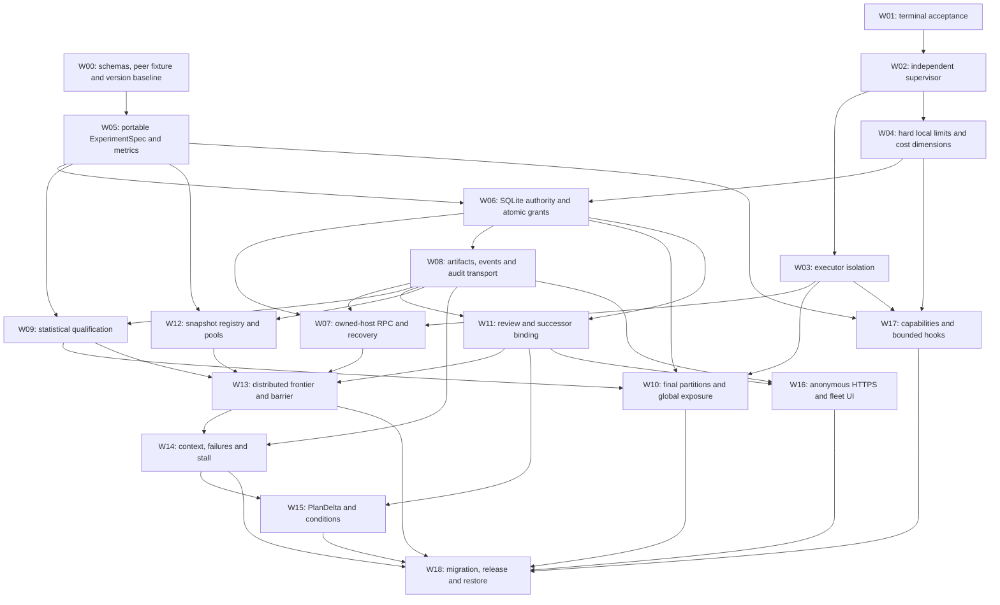
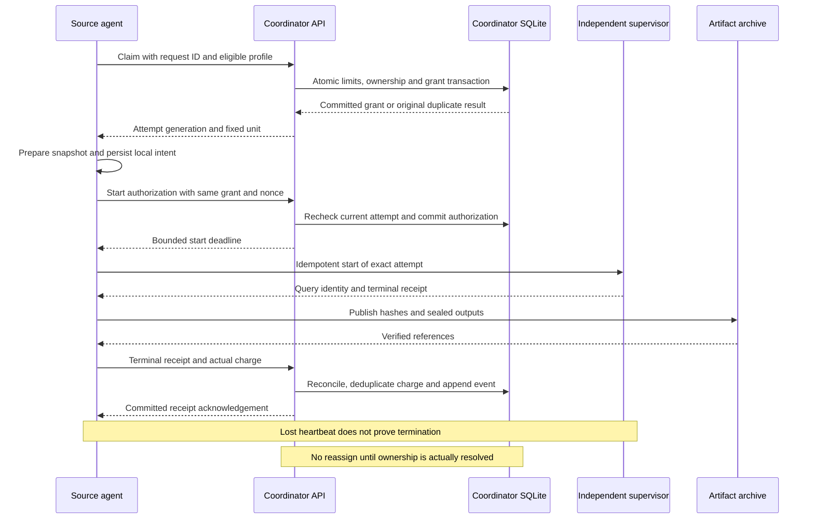

# Implementation Plan: P0–P2 Distributed Autoresearch

Created: 2026-10-28T19:37:01-07:00
Status: ready for design review; implementation has not started.
Branch: `dist-exec`; inspected HEAD `e88e7bac3ec2b4056ab42098e6e8b71e7524d283`.
Runtime source baseline: `33ef750face59b42f9663c8e355a77600d1765e7`, package `0.5.8`, protocol/store `2`.
Scope: all P0–P2 targets from the safety and adoption plans, plus the distributed execution/HTTPS prerequisites incorporated into the current 1205 plan.

## User Prompt, Verbatim

```text
write an actionable plan for all P0-P2 targets for review.
```

## Review Basis and Completion Definition

This is the execution plan for the existing architecture, not another architecture
rewrite. The current working-tree 1205 revision `r7` is authoritative for SQLite
and anonymous POC access. The 1147 roadmap contributes execution/statistical safety;
1503 contributes prioritized donor mechanisms. Their priority IDs overlap, so the
coverage table below identifies both sources explicitly.

| Source document | SHA-256 of the reviewed input |
|---|---|
| [261028-1147-todo-with-priority.md](261028-1147-todo-with-priority.md) | `2551e6ffa23808c336a203f2020b53812e116cda5d2302d66e953d65343ea2ce` |
| [261028-1205-host-review-dashboard-over-https.md](261028-1205-host-review-dashboard-over-https.md) | `cd9c2bf7c95706eccc317b0649df15b15f324f0039ad9f7204f025d5350f4032` |
| [261028-1503-fork-feature-adoption-priorities.md](261028-1503-fork-feature-adoption-priorities.md) | `e86122cfdee72ba842a856f634940fb5f6f8d6ff37ef711067272aed222cf2dc` |

The English and Chinese 1205 plans currently have uncommitted POC amendments. Their
working-tree policy is used here; HEAD alone does not contain that policy. Leave
existing artifacts intact and implement from a subsequently reviewed/committed
snapshot. This artifact requests design review, not experiment launch or deployment.

P0–P2 is complete when the package gates below pass: an isolated finite search runs
across two source hosts, complete costs and evidence are reconciled through one
SQLite coordinator, top-k contains only qualified positives, an exact procedural
independent review gates the next round, final promotion respects sealed data, and
plans/artifacts/responses/replies can be restored and audited. Missing systemd,
container, GPU or remote-host integration evidence leaves the corresponding package
unqualified; a mock or skipped test cannot establish that capability.

## Fixed Decisions for This Plan

- **Peer repositories:** autoresearch Git owns generic implementation, protocols,
  fixtures, UI and deployment templates. Subject Git owns scientific plans/slates,
  candidate code/configuration, adapters/verifiers, criteria and accepted changes.
  Every unit pins both repositories, the installed framework and its input/evaluator.
- **Global authority:** one coordinator instance on one host owns round/goal/budget,
  attempt grants, review application and exposure state in a local SQLite database.
  Remote agents access it through HTTPS; they never open its file over NFS.
- **Local execution:** Linux owned-host agents with qualified executor/supervisor
  profiles and durable local outboxes. A control-plane outage cannot erase local
  deadlines or authorize new work. Unknown launch state requires reconciliation.
- **POC access:** `access_mode=anonymous_poc`; all declared API/evidence reads and
  writes, including integration and reviewer submissions, require no login, client
  credential, cookie or `X-Review-Token`. Credential-free CORS/OPTIONS works.
  Actor/host/reviewer labels are self-reported, with `poc_anonymous` assurance.
  Independent review is procedural; verified reviewer identity is a later profile.
- **Business gates:** anonymous access does not bypass frozen contracts, schemas,
  hash/idempotency rules, global budget/resource/exposure or exact next-round review.
  Grant generations are state-correlation fields, not authentication credentials.
- **Promotion:** frontier qualification uses declared exploration/validation data;
  final scientific/release promotion uses the frozen final-confirmation boundary.
  Reviewer approval and data confirmation are separate records and checks.
- **Git cost:** N candidates do not imply N shared branches. Use configuration
  manifests/detached subject commits, bounded workspaces, a verified snapshot archive,
  and one writer for at most k active retained path branches plus a campaign branch.
- **Versioning:** new distributed/search/confirmation schemas are opt-in for new
  campaigns. Do not upgrade a frozen active runtime or rewrite old packet bytes.

## Coverage of All Targets

| Original target | Implementation package(s) | Evidence required to close it |
|---|---|---|
| 1147 P0-1: timeout always invalidates acceptance | W01 | Cooperative TERM/zero-exit receipt is interrupted and invalid. |
| 1147 P0-2: independent orphan supervision | W02, W07 | Deadline and cancellation survive worker/agent/coordinator loss. |
| 1147 P1-1 and 1503 P0: execution isolation | W03 | Real qualified profile denies source writes/network and contains process effects. |
| 1147 P1-2: hard resource/cost ceiling and stall policy | W04, W06, W14 | Complete-route limits/charges include startup/grace/failures; stall record has a bounded action. |
| 1147 P2-1: statistical promotion, matched controls and ablation | W09, W10 | Explicit replicates/comparison policy, budget-matched controls and required ablations; sealed final gate. |
| 1147 P2-2: metric meaning, joint gates and final partitions | W05, W09, W10 | Typed conjunctive criteria, proxy-regression negative case and final-data exclusion during search. |
| 1503 P1-1: frozen generic experiment setup | W00, W05 | Peer-root specification compiles to fixed argv, inputs, guards and baseline. |
| 1503 P1-2: evidence-bound review/identity | W11 | Exact review binds the successor; POC assurance is honest, and identity-provider interface is distinct. |
| 1503 P1-3: repeated qualification and correctness | W09, W10 | All samples/seed/protocol identities present; quick/noisy successes do not qualify alone. |
| 1503 P1-4: resource-aware frontier/workspace pool | W12, W13 | Global/local concurrency, task/barrier and shared-branch limits pass. |
| 1503 P2-1: durable context and conditional failure revisit | W14 | Context rebuilds from records; revival binds changed assumptions/evidence and reviewed scope. |
| 1503 P2-2: typed plan deltas/inherited conditions | W15 | Changed fields and conditions bind evidence and new subject plan; no live-contract mutation. |
| 1503 P2-3: frontier/claims/evidence/decision observability | W08, W16 | Complete bilingual views, response/reply links and verifiable offline bundle. |
| 1503 P2-4: hardware preflight/bounded hooks | W17 | Capability decisions freeze before execution; hooks remain bounded and advisory. |
| 1205 A/C/E: portable contracts, SQLite/global ownership and distributed adapter | W00, W05–W08 | Two hosts materialize identical logical units; race/partition/failure conformance passes. |
| 1205 F/G/I: distributed round, anonymous HTTPS and migration/recovery | W11–W13, W16, W18 | Two-host reviewed successor and restore rehearsal, with legacy costs/exposure retained. |

P3 platform ports, vendor SDKs, one candidate's multi-node training, automatic database
failover and broad paper/literature stacks are excluded. The owned-host distributed
adapter is included because the current 1205 design promoted it into the core scope.

## Package Dependency Graph

A package can be implemented independently after its prerequisites, but enabling a
capability waits for its real acceptance gate. Package ownership below is by module,
not an instruction to spawn agents or change multiple repositories indiscriminately.



## Deliverables and Code Boundaries

Existing runtime files referred to below are relative to
`runtime/src/autoresearch_runtime/`. Proposed new modules/tests/commands do not
currently exist. Keep worker/core imports standard-library-only; optional statistics,
container or object-storage integrations belong behind extras/adapters. Vendor training
and model SDK dependencies stay outside the generic runtime.

| Area | Primary owner / proposed files | Integration surface |
|---|---|---|
| Local lifecycle | W01–W04: `worker.py`, `controller.py`, new `supervisor.py`, `executors/`, `resources.py`, `costs.py`. | Stable start/query/cancel/receipt contract. |
| Portable scientific contract | W05/W09/W10: new `experiment_spec.py`, `portable_contract.py`, `metrics.py`, `qualification.py`; `protocol.py`, `confirmation.py`. | Immutable UnitSpec and evaluator adapters. |
| Global state/transport | W06–W08: new `global_store.py`, `control_plane.py`, `host_agent.py`, `audit.py`, `artifacts.py`; reuse `store.py`. | Transactions, grants, event/artifact commit and recovery. |
| Search/review | W11–W15: new `review_policy.py`, `search.py`, `snapshots.py`, `context.py`, `plan_delta.py`; explicit `goals.py` adapter. | Frontier, exact reviewed successor and subject plan changes. |
| Product/preflight | W16/W17: new `hosting.py`, `capabilities.py`, `hooks.py`; `cli.py`, `review.py`, `live_review.py`, `review_history.py`, `inbox.html`, `zh-CN.json`. | Anonymous POC route policy, views, immutable evidence. |
| Release | W18: `runtime/pyproject.toml`, `__init__.py`, `runtime/docs/`, `runtime/deploy/`, package fixtures and CLI examples. | Explicit new-campaign adoption and legacy read/reconciliation. |

Do not have several packages independently rewrite `controller.py` or `goals.py`.
W00 establishes their interfaces; package changes land sequentially when they touch
shared modules. A selected real subject receives its own adapter/plan PRs after its
rules and inputs are read. Framework conformance uses a generated small subject Git
repository in test scratch; do not embed actual subject research into framework Git.

## W00 — Freeze Interfaces, Schema Versions and a Review Fixture

**Priority:** prerequisite. **Depends on:** none. **PR:** framework interface/fixture.

1. Record the current source/package/store versions and baseline verification on
   Linux. Create a fixture builder that initializes a subject Git repo, plans/code,
   a deterministic metric/guard, private final data, and isolated run roots.
2. Freeze the schemas and API error/idempotency rules listed below. Separate portable
   hashes from host-specific paths and legacy runtime identities. Define optional
   actor assurance independently of workflow eligibility.
3. Add a distributed store/protocol version and a compatibility matrix. New commands
   opt into new stores; legacy `run/resume` keep their existing interpretation.

**Files:** new schema/fixture modules and `runtime/tests/fixtures/`; existing
`protocol.py`, `cli.py`, `__init__.py`, and compatibility docs.
**Acceptance:** two different host roots resolve the same logical contract hash;
wrong framework/subject refs and missing inputs fail before launch. Legacy packets
and campaigns remain readable without silently migrating an active source closure.
**Review evidence:** schema examples, compatibility table, Linux baseline log.

## W01 — Terminal Execution Must Precede Scientific Acceptance

**Priority:** P0. **Depends on:** existing installed-runtime test baseline; W00 can
proceed independently. **PR:** focused worker correctness fix.

1. Require `execution_status == completed`, successful return code, and passing
   fixed verification for scientific acceptance. All other terminal statuses retain
   verifier details but publish invalid evidence.
2. Keep raw return code, actual elapsed time and diagnostic verifier output. Ensure
   controller reconciliation cannot later promote an interrupted receipt.
3. Extend the existing timeout and scientific-gate behavior tests with a child that
   handles TERM, writes a passing result, and exits zero.

**Files:** `worker.py`, `controller.py`; existing `test_runtime.py`, neighboring
worker tests if isolated coverage is useful.
**Acceptance:** exact receipt tuple is interrupted/returncode 0/scientific false/
evidence invalid. Normal success and normally completed scientific failure stay
correct. A controller restart preserves the invalid terminal outcome and charge.
**Review evidence:** before/after CPU fixture receipt and focused regression results.

## W02 — Deadline Authority Independent of Worker and Agent

**Priority:** P0. **Depends on:** W01. **PRs:** supervisor protocol, then Linux backend.

1. Define immutable start intent, supervisor job ID, boot/process identity, start
   window, monotonic execution duration and hard deadline. Make start/query/cancel
   idempotent for one attempt and keep records outside disposable workspaces.
2. Implement a qualified Linux service-manager backend, initially systemd transient
   units with RuntimeMaxSec and whole-cgroup termination. Deadline enforcement must
   survive loss of the worker, agent, and coordinator. A controller-only recovery
   timer is insufficient while the controller is unavailable.
3. Publish a terminal receipt after confirmed teardown. Preserve unknown launch and
   active leases until actual query/cancellation evidence resolves them. Define
   container cleanup for W03 separately from killing a Docker client.

**Files:** new `supervisor.py`, systemd backend/service definitions; worker/controller
integration and `runtime/deploy/`; new `test_supervisor.py` plus Linux conformance.
**Acceptance:** terminate worker/agent/controller before, during and after launch;
the independent deadline still ends the process tree, with no blind restart or early
lease release. Test TERM-ignore/KILL escalation and boot/PID reuse. Fixtures clean
all descendants and locks. Unavailable backend is reported unqualified, not passed.
**Review evidence:** real Linux service/process teardown trace and preserved receipts.

## W03 — Qualified Executor Profiles and Least-Privilege Runs

**Priority:** P0 in adoption / P1-1 in safety. **Depends on:** W02.

1. Add `local-direct` compatibility and `local-container` qualified interfaces that
   consume frozen argv/cwd/env/mount/image specs; task fields cannot loosen the profile.
2. For container mode, bind read-only source/input/evaluator, unit-only writable
   outputs/scratch, disabled network, controlled non-root UID, dropped capabilities,
   no-new-privileges, and CPU/memory/PID limits. Declare GPU assignment separately.
3. Independently own container identity/timeout/removal through the supervisor's
   service cleanup or a persistent container deadline controller. Prove cleanup
   when its parent command dies; killing `docker exec` alone is not cancellation.
4. Record profile/image/resources and assurance in each receipt. `local-direct`
   retains its explicitly procedural trust limits; it cannot claim enforced isolation.

**Files:** new `executors/base.py`, `direct.py`, `container.py`; supervisor/resources
integration, contract validation; new `test_executors.py` and backend conformance.
**Acceptance:** actual CPU container fixture denies source/input writes and network,
permits declared outputs, respects PID/memory limits, avoids undeclared descriptor
leakage and terminates after agent death. GPU mode remains unqualified until tested
on its actual driver/device/runtime; mock Docker cannot close that gate.
**Donor:** FAROS profile/cleanup patterns, adapted to frozen-source requirements.

## W04 — Hard Deadlines, Complete Costs and Local Resource Reservations

**Priority:** P0 prerequisite / safety P1-2. **Depends on:** W02; integrates W03.

1. Separate work time, startup/prepare/evaluator/grace, hard elapsed limit, aggregate
   resource-time, and optional priced cost dimensions. Store exact integer units
   and rate/version metadata rather than ambiguous floating currency totals.
2. Derive a bounded launch/start deadline and reserve all phases before execution.
   Charge failed/invalid/cancelled attempts and reconcile unused reservation only
   after verified never-started/terminal state. The grant deadline includes teardown.
3. Lease declared local devices/ports/fixtures and host capacity atomically. A GPU
   memory estimate alone does not permit simultaneous latency benchmarks on the
   same timing resource. Expose projected versus actual costs in receipts/status.

**Files:** new `costs.py`, `resources.py`; controller/supervisor integration and
`goals.py` adapter; new `test_costs.py`, `test_resources.py`, relevant goal tests.
**Acceptance:** reject work whose startup/grace cannot fit, preserve full failed-run
cost, include downstream obligations and enforce each declared hard dimension.
Unsupported dimensions fail qualification explicitly. No claim of hard money limits
for a provider/API lacking a bound or cancellation mechanism. Stall belongs to W14.

## W05 — Portable ExperimentSpec, Metrics and Baseline Guards

**Priority:** P1 setup / safety P2-2 semantics. **Depends on:** W00.

1. Compile subject-authored ExperimentSpec into immutable portable UnitSpec: both
   Git refs, logical roots, fixed argv/input/evaluator, declared mutations, metrics,
   baseline/guard, permitted resources and finite route budget.
2. Add typed finite numeric metrics: name, unit, direction, comparison, threshold,
   minimum useful effect, scientific meaning and benchmark fingerprint. Retain exact
   JSON checks; new comparator semantics are an explicit protocol version.
3. Use conjunctive acceptance for primary/proxy and required downstream/usability
   metrics. Validate baseline before searching; neither agent proposals nor hooks
   can modify frozen metric/guard code to make a candidate pass.
4. Resolve host paths/mounts into immutable HostBinding and hash the local closure
   separately. Reject traversal, undeclared sources and incompatible input profiles.

**Files:** new `experiment_spec.py`, `portable_contract.py`, `metrics.py`; protocol/
CLI integration; new `test_experiment_spec.py`, `test_metrics.py`.
**Acceptance:** a CPU subject fixture supports lower/higher goals, zero baselines,
multiple guards and finite JSON selectors. Malformed/NaN/Inf/missing data, unit or
benchmark mismatch, source drift and a faster-but-wrong proxy result fail explicitly.
**Donors:** codex/pi setup and parsing; domain meaning stays in subject Git.

## W06 — Coordinator SQLite Authority and Global Accounting

**Priority:** distributed-core P1. **Depends on:** W04, W05.

1. Implement one coordinator-local DB with WAL, `synchronous=FULL`, foreign keys,
   bounded busy timeout and short `BEGIN IMMEDIATE` writer transactions. Large blobs,
   hashing, execution and network calls stay outside writer locks.
2. Implement the table/constraint families below: one active leader, complete-round
   budget/reservation, one unresolved owner per unit, immutable attempts/nonces,
   reviewer application, global exposure, receipt charges and transactional outbox.
3. Use conditional generation/state updates and unique idempotency IDs; retry reads
   return the original committed result. Recheck scope/gates within transactions.
4. Add online backup, integrity check, schema migrations, leader lock/epoch and
   recoverable cursors. Leadership restart preserves registered grants; it cannot
   invalidate or recreate their physical execution merely by changing epoch.

**Files:** new `global_store.py`, migrations, transactional control functions;
`store.py` backup reuse; new `test_global_store.py` with multi-process writers/readers.
**Acceptance:** races cannot exceed global/local caps or create concurrent owners;
BUSY/disk-full/crash before commit cannot acknowledge a grant, charge or application.
Restore reconciles old grants/exposure/cost. No remote host connects to the DB file.
**Review evidence:** transaction diagrams, constraint definitions and failure results.

## W07 — Owned-Host Agent and Partition-Safe Execution RPC

**Priority:** included distributed-core. **Depends on:** W03, W06, W08.

1. Implement the declared anonymous integration routes and a host agent polling
   them over verified HTTPS. Enrollment/profile labels are self-reported in POC;
   enrollment does not bypass compatibility or unit/resource requirements.
2. Grant claim with unit/attempt/generation; prepare frozen snapshot and persist
   local intent, then request idempotent start authorization before supervisor launch.
   Persist start/terminal receipts and retry delivery through the local outbox.
3. Query the same supervisor identity after agent/coordinator restart. Reassignment
   requires never-started or verified teardown evidence; heartbeat expiry merely
   marks uncertain scheduling state. Grant generation rejects old state updates.
4. Apply explicit hold/drain/cancel and bounded retry/replicate quotas. Preserve late
   receipts/cost for audit without letting stale generations replace an outcome.

**Files:** new `host_agent.py`, `control_plane.py`, integration routes and systemd
agent units; new `test_host_agent.py`, `test_distributed_rpc.py`, two-node conformance.
**Acceptance:** sever the connection after claim/start/receipt and kill each process.
No concurrent replay occurs; retrying identical requests returns existing grants/
receipts, uncertainty retains reservation, verified teardown enables permitted
recovery. No arbitrary command outside the frozen graph can execute through an API.

## W08 — Immutable Artifacts, Messages, Events and Share Bundles

**Priority:** distributed prerequisite / P2 audit. **Depends on:** W06.

1. Export canonical stored packet bodies/evidence, original timestamps and stable
   IDs; enriched snapshots are views. Import dependencies before linked workflows
   and historical dispositions. Legacy origin namespaces preserve bytes/hash.
2. Implement versioned content-addressed artifact storage with atomic manifest
   commits, verified size/hash/format, immutable ID conflicts and retryable uploads.
   Distinguish local-durable/server-committed/archive-verified acknowledgements.
3. Append audit/message records with producer sequence, actor assurance, typed refs,
   causal parents and `in_reply_to`; status is a projection. Edits/cancellations append
   superseding records. Historical missing parent/actor evidence is disclosed.
4. Export a verifiable audit bundle; retention/cleanup requires referenced bytes
   archived, no live/unresolved/outbox dependency and preserved frozen environments.

**Files:** new `artifacts.py`, `audit.py`, storage adapter and `sync.py`; review/import
adapters; new `test_artifacts.py`, `test_audit.py`, canonical migration tests.
**Acceptance:** fail corrupt/conflicting/partial bytes; retry interrupted uploads,
restore missing local candidate objects, rebuild delivery projections and verify an
offline bundle after workspace removal. Anonymous APIs expose published evidence;
raw private labels, DB files and storage credentials are not arbitrary path reads.

## W09 — Qualification, Statistical Controls and Ablations

**Priority:** adoption P1-3 / safety P2-1 and P2-2. **Depends on:** W05, W08.

1. Compile qualification graph with explicit seed/replicate IDs, matched input/
   evaluator/fidelity/hardware strata, baseline controls, minimum effect and required
   uncertainty/multiple/adaptive-comparison policy. Record every sample and failure.
2. Require a trusted subject evaluator/statistics adapter to emit recomputable
   method/version, sample references, corrected intervals/decision and assumptions.
   The framework verifies presence/completeness/binding, not invented scientific truth.
3. Include budget-matched random search and a classical optimizer control when a
   structured search space supports one. Require a documented non-applicability
   rationale otherwise; compare within the same scope/cost dimensions.
4. Require declared ablations for bundled changes. Separate cheap screening from
   complete qualification; a screen can allocate qualification but cannot promote.

**Files:** new `qualification.py`, optional reference statistics adapter/extras,
fixture evaluators; new `test_qualification.py`, matched-control/ablation fixtures.
**Acceptance:** missing/mislabeled seeds, changed benchmark/candidate, incomplete
replicates or proxy-regression cannot qualify. Known-positive/negative/noisy data,
corrected comparisons and ablations have deterministic declared outcomes. MLX's
fixed-seed helper and code-only hash are not copied as qualification authority.

## W10 — Final Partitions and Global Confirmation Exposure

**Priority:** safety P2 final promotion. **Depends on:** W06, W09; executor W03.

1. Separate exploration/validation/final input references before search. Final labels
   are excluded from ordinary iterative UnitSpec and mounted only in a qualified
   confirmation executor. Optional validation-shard rotation is predeclared and
   labeled reused development evidence; it does not erase adaptive-selection bias.
2. Implement global dataset/population/cohort/subject exposure reservation in the
   same coordinator transaction domain; hostname, branch or campaign rename never
   creates freshness. Failed/uncertain openings stay consumed.
3. Freeze finalist candidate set, joint evaluator/multiplicity plan, input identities,
   costs and allowed aggregate outputs before the opening. Add batch confirmation
   schema while preserving existing single-candidate procedural semantics.
4. Gate final scientific/release promotion on complete corrected qualification and
   permitted one-time final evidence. A new iteration influenced by final results
   treats that data as exposed and requires a new authorized confirmation design.

**Files:** `confirmation.py` adapter, global exposure tables, new final-promotion
policy; `test_confirmation.py` extensions, `test_global_confirmation.py`.
**Acceptance:** concurrent hosts cannot reopen subjects; ordinary search rejects final
inputs; crash/missing receipt conservatively consumes opening; raw labels/private
verifier logs do not enter public packets. Config-only finalists receive a clean
frozen evaluator/config bundle or an explicitly versioned equivalent identity.

## W11 — Bound Review Decisions and Successor Application

**Priority:** P1 review. **Depends on:** W06, W08.

1. Create SelectionRecord/ReviewReceipt schemas binding project/round, exact candidate
   and qualification hashes, next-slate hash, both Git refs, scope/budget and report.
   Handle approve/reject/changes-requested as immutable events.
2. In `anonymous_poc`, accept valid anonymous decisions, record optional self-reported
   reviewer labels plus `poc_anonymous`; state that independence is procedural and
   unverified. Provide an actor-assurance adapter interface for future authentication.
3. At the global round checkpoint, atomically recheck evidence/current context and
   apply the exact decision once. No host locally promotes its own next iteration.
4. Preserve explicit stops/holds and stale decisions. Edited next slate/evaluator/
   parent/budget/refs require a new review revision; advisory replies and acknowledgements
   are not approvals. Record public adoption/defer/reject disposition separately.

**Files:** new `review_policy.py`, coordinator/schema integration, review queue;
new `test_round_review.py`, existing feedback/revision tests.
**Acceptance:** valid anonymous POC decision succeeds with accurate assurance;
stale/wrong-round/conflicting binding cannot advance. No successor claim exists before
application. Verified-principal/self-review rejection is tested only if that optional
profile is implemented; it is not falsely claimed as a POC acceptance guarantee.

## W12 — Subject Snapshots, Pooled Workspaces and Promotion Writer

**Priority:** P1-4 Git cost. **Depends on:** W05, W08.

1. Register configuration manifests or immutable detached subject commits, preserving
   all files/modes and prerequisite objects. Pin expected candidate tree in UnitSpec;
   no experiment edits enter framework Git or the live subject checkout.
2. Materialize verified snapshots in bounded host slots. Lease/reconcile a slot before
   reuse, keep output/cache unit-scoped and source frozen; archive bundles before
   releasing final refs. Grant preparation capacity is separate from evaluation C.
3. Add one subject promotion writer with expected-old-ref checks. Advance at most k
   active retained path refs and an optional campaign ref; archive retired losers.
4. Integration/merge/rebase that changes evaluated bytes creates revalidation and
   applicable review requirements. Branch names are navigation, not execution pins.

**Files:** new `snapshots.py`, `workspace_pool.py`, `promotion.py`; new
`test_snapshots.py`, `test_workspace_pool.py`, subject Git fixture cases.
**Acceptance:** restore any losing snapshot from its verified archive; concurrent
workers cannot share a dirty source/output slot; N=24 does not create N public refs.
Expected-ref drift blocks promotion without rewriting human changes.

## W13 — Distributed Round Barrier and Positive Top-k Frontier

**Priority:** P1 search. **Depends on:** W07, W09, W11, W12.

1. Compile the finite RoundPlan into unique candidate/phase/replicate tasks under
   one complete global admission. Enforce prerequisites and C_global/C_host/resource
   ceilings transactionally, with no implicit child tasks or unbudgeted retries.
2. Reconcile the full expected inventory before sealing. Uncertain attempts hold the
   barrier; cancelled/invalid or protocol-skipped units get explicit records/cost.
3. Rank only completed evidence-valid and scientifically positive QualificationRecords,
   within compatible strata or a frozen jointly validated comparator. Deterministic
   ties/diversity and at-most-k are mandatory; zero positives yield reorientation.
4. Freeze successor candidates/budget and await W11 application before admission.
   Count actual compute across all hosts, not just reduced wall-clock waves.

**Files:** new `search.py`, scheduler/global-store integration and frontier strategies;
new `test_search.py`, `test_round_barrier.py`, distributed fixture.
**Acceptance:** N=24/C_global=8/four C_host=2/k=3 preserves all outcomes, fewer-than-k
and zero-positive cases, no rank-by-arrival, no barrier bypass on a lost host, and
no successor launch without exact review. Independent timing leases prevent biased
qualification from sibling process/GPU contention.

## W14 — Canonical Context, Failure Retrieval and Bounded Stall Actions

**Priority:** P2-1 plus safety resource/stall requirement. **Depends on:** W08, W13.

1. Derive a size-bounded context pack from canonical refs/events: objective, pins,
   frontier/cost, evidence, failed hypotheses, pending review and next authorized tasks.
   Include source cursors; invalidate stale summaries and disclose missing records.
2. Persist failure reason/constraint, assumption/context and evidence. A revival
   references the prior run and changed evidence/assumption; a verification replicate
   is a separate declared protocol, not an unrestricted retry of a rejected path.
3. Add a predeclared stall policy over fully comparable sealed rounds: epsilon,
   window length, finite diagnostic/pivot budget and required action. Noise/invalid
   or pending data cannot count as a scientific stagnation finding.
4. Emit a durable diagnose/pivot/hold/stop disposition and reviewed reorientation.
   Existing authorized procedural recovery is bounded; scientific pivots/scope or
   explicit user stops retain their separate gates.

**Files:** new `context.py`, `failure_index.py`, `stall.py`; goal/steering adapter;
new `test_context.py`, `test_failure_revisit.py`, `test_stall.py`.
**Acceptance:** context rebuilds after session reset; partial/contradictory events
cannot fabricate best results. Changed-assumption revival binds new evidence; unchanged
rejected slates cannot loop. Declared stagnation uses complete comparable rounds and
never overrides explicit stop or creates free downstream budget.

## W15 — PlanDelta and Inherited Acceptance Conditions

**Priority:** P2-2. **Depends on:** W11, W14.

1. Define typed before/after changes with trigger/evidence/qualification references,
   feasible candidate audit, content hash, condition dependencies and expected effect.
2. Verify changed fields against prior plan and materialize a proposed successor
   subject document/config. Evidence/subject changes return bound conditions to pending;
   non-waivable scientific constraints cannot become optional prose.
3. After exact approval, write a new subject plan commit with prompt/revision history,
   snapshot it, and compile a new contract/slate. Never amend active execution in place.
4. Link reviewer reply, global application, agent acknowledgement/disposition and
   accepted plan commit. Expected effects remain predictions until a new run measures them.

**Files:** new `plan_delta.py`, condition verifier and subject adapter hooks;
new `test_plan_delta.py`, `test_condition_binding.py`.
**Acceptance:** unknown evidence, infeasible selected candidate, unchanged/wrong prior
fields and stale condition hashes fail. Approved changes reproduce the exact next
slate; source contract/old evidence remains unchanged and auditable.

## W16 — Anonymous HTTPS Fleet Dashboard and Review/Artifact APIs

**Priority:** P2-3 plus core hosting. **Depends on:** W08, W11; W13 enriches search views.

1. Add hosted API/CLI entry points and TLS proxy/service templates. Default POC mode
   accepts all declared read/write operations without client authentication/tokens;
   credential-free CORS/OPTIONS and CLI without Origin work. Other profile is separate.
2. Attach global/host providers to existing canonical history views. Display host,
   grant/generation, qualification samples/constraints, whole inventory/frontier,
   claims/evidence, replies, procedural reviewer assurance, and archive/application state.
3. Separate browser refresh, host heartbeat, authored report time and execution state.
   A thirty-second stale-display threshold is not reassignment authority. Preserve
   pinned old revisions, immutable bytes, per-packet drafts and both locales.
4. Add verified artifact downloads/audit-bundle export, health/readiness and bounded
   size/pagination/timeouts. Never accept arbitrary server filesystem paths in API fields.

**Files:** `hosting.py`, routes/provider adapters, existing review/history/HTML/locale
files, `runtime/deploy/`; `test_hosting.py`, `test_poc_access.py`, actual-template JS tests.
**Acceptance:** anonymous reads/uploads/replies/reviews/agent RPC work with no cookies,
credentials or X-Review-Token; wrong schema/hash/stale generation still fails. A browser
on another machine sees complete bilingual history and decision delivery/application.
Unpublished labels/database files are not served. Authenticated profile deployment
and enforced identity are not prerequisites for POC readiness.

## W17 — Frozen Capability Preflight and Advisory Hooks

**Priority:** P2-4. **Depends on:** W03, W04, W05.

1. Record supported OS/executor/image, GPU/device/precision/VRAM, memory/CPU capacity,
   expected workload profile and measurement isolation before freezing a unit.
2. Convert profile choice into immutable configuration and eligibility. Resource-
   unknown hosts cannot silently adopt another precision/batch/evaluator during a run.
3. Add typed declared lifecycle hooks with fixed argv/closure, execution profile,
   deadline, output limit and budget reservation. Deliver stdout as advisory context;
   no hook may grant review approval or rewrite frozen contracts/evidence.
4. Preserve plain configuration without hooks as the default; adapters own domain
   preflight meaning. Record hook receipts/failures and any waived optional behavior.

**Files:** new `capabilities.py`, `hooks.py`; resource/contract integration and
`test_capabilities.py`, `test_hooks.py`.
**Acceptance:** insufficient/changed capabilities deny incompatible work; bounded
hooks survive timeout with correct cost and sanitized bounded output. Hook text cannot
authorize successor work. Cross-platform training ports remain outside this package.

## W18 — Legacy Migration, Full Review Demonstration and Release

**Priority:** completion gate. **Depends on:** W10, W13–W17 and their prerequisites.

1. Back up and reconcile legacy local campaign/goal/inbox state. Import canonical
   history with origin namespaces, original hashes/times and historical costs/exposure;
   deduplicate imports and retain unresolved reservations. Never initialize a fresh
   global budget to erase a project's prior consumption.
2. Adopt explicit new stores/protocols on new campaigns. Publish package/version,
   install-from-wheel check, dependency/profile declarations, CLI/examples, TLS/node
   setup, operator/cancel/restore runbooks and subject-adapter requirements.
3. Exercise one-host conformance, two-host partition/cancellation, then four-source
   logical scheduling. Run a controlled full review loop and a one-time sealed final
   promotion fixture separately, with all audit objects archived.
4. Restore coordinator, review view and source outboxes from a catalog; reconcile
   grants/receipts/charges/exposure before new work. Preserve unverified assurance.

**Files:** migrations, `store.py`, compatibility docs and package metadata;
`test_migration.py`, release/end-to-end scripts, `runtime/docs/verification/`.
**Acceptance:** independent bundle verifies without original workspace; old report
hashes/costs/pauses/exposure survive import and restore; no old approval follows a
changed slate. Missing Linux/container/two-host evidence prevents qualified release.

## Coordinator Schema and API Contract for Review

Use one DB transaction domain for invariants. The following table families are
minimum required state, not permission to introduce a second execution authority.

| State family | Constraints / transactional rule |
|---|---|
| Projects, immutable specs/rounds/units | Globally unique IDs; frozen body hash; expected task graph and parent refs. |
| Leadership, host profiles and resource allocations | One active coordinator writer authority; conditional epoch updates; host capacity and global limits. |
| Attempts/grants/start intents | Unique request/attempt/nonces; at most one unresolved owner per logical unit; conditional generation/state transition. |
| Budgets, reservations and charges | Exact dimension/rate units; grant capacity is carved from the round reservation, not double-reserved; charges deduplicated and unresolved reserve retained. |
| Qualification, selection and review application | Referenced immutable records; complete-round barrier; exact current selection/slate and review applied once. |
| Confirmation openings/populations/subjects | Global unique exposure identity and immutable opening body; failed/uncertain openings remain consumed. |
| Artifact manifests, messages, events, outbox | Immutable subject/payload hashes; reply parents; durable event sequence; projection updates and outbox event in one transaction. |

`BEGIN IMMEDIATE` protects checks and updates together. Use writer transactions only
for bounded state changes; prepare/hash/upload outside them. On BUSY/commit failure,
return an error without claiming success. The local store never shares its file via
network mounts. SQLite online backup/integrity/checkpoint tests are required.

| Proposed route family | Required payload and result |
|---|---|
| `/integration/v1/hosts/enroll`, `/capacity` | Self-reported host/boot/profile + protocol; registered compatibility and capacity record. |
| `/integration/v1/units/claim`, `/prepare`, `/start` | Project/unit/request/attempt/generation and binding; original committed grant/start result on duplicate. |
| `/integration/v1/units/heartbeat`, `/query`, `/cancel`, `/receipt` | Bound attempt, supervisor state/receipt, costs and artifact refs; stale update rejection and audit retention. |
| `/api/rounds`, `/selection`, `/review`, `/control` | Frozen round/select/evidence/slate refs, decision and optional actor labels; queued/applied/stale state with receipts. |
| Existing `/api/inbox`, `/api/history`, report/experiment/evidence routes | Compatible immutable report views and additional global provider state. |
| Existing `/api/feedback`, new conversation/artifact/bundle routes | Durable accepted message or verified artifact commit, reply parent and ID/hash conflict checks. |

Exact path/layout can be adjusted in W00 without changing invariants. Response errors:
400 invalid schema/path/metric, 404 missing route/object, 409 immutable/stale/generation
conflict, and retryable 503 store/lock/availability errors. Evidence commit completes
only after verified references; a 202 queue acknowledgement does not claim execution,
application or archive durability. No 401/403 merely for anonymous identity in POC.

This sequence is the minimum acceptance trace for a retryable distributed unit.



## Milestones and Proposed PR Order

| Milestone | Packages / review units | Deliverable to inspect |
|---|---|---|
| M0 — Contracts and urgent correctness | W00, W01 | Schema/compatibility baseline and TERM-zero fix receipt. |
| M1 — Qualified local execution | W02, W03, W04 | Supervisor/container conformance and complete hard-cost/lease evidence. |
| M2 — Global and scientific contracts | W05, W06, W08, W09, W10, W11, W12 | SQLite race/restore, typed metric/qualification/final/review contracts and recoverable snapshots. |
| M3 — Distributed reviewed loop | W07, W13, W16 | Two-host execution, anonymous HTTPS round views and pending-to-applied next-round review. |
| M4 — All P2 and release | W14, W15, W17, W18 | Context/revisit/stall, reviewed plan change, preflight/hooks and full recovery/audit bundle. |

Each W package is one focused PR or a small interface/conformance pair. Land changes
to shared modules sequentially and stage exact files. Donor algorithms/contracts are
adapted behind current interfaces with provenance/notices checked before literal code
reuse. Do not merge a complete third-party scientist stack or change subject Git as a
side effect of a framework package. Actual subject adapter work has its own review.

No calendar estimate is fixed before M0 qualifies runner/backend availability. Track
package status, remaining conformance evidence and blockers in the verification
manifest, so unavailable infrastructure cannot be hidden behind an optimistic date.

## Test Lanes and Review Evidence

| Lane | Purpose | Gate |
|---|---|---|
| Portable unit/contract tests | Schemas, metrics, state folding, SQLite transactions, review/delta and API semantics. | Each affected package passes its focused suite. |
| Linux process lifecycle | Real process/service identity, deadlines, orphan cleanup, leases and boots. | W02/W04/W07 cannot close without it. |
| Container/backend conformance | Actual mounts, network/resources and independent container cancellation. | W03/profile qualification required. |
| Two-host failure injection | Actual separate roots/agents, connection loss, generation and restore behavior. | W07/W13/M3 required; localhost multiplexing is a supplemental simulator. |
| Scientific fixture | Reproducible sample/control/ablation/final partition and exposure cases. | W09/W10 protocol mechanics pass; real subject must qualify its domain criteria. |
| Actual-template/browser | Bilingual histories, pins/drafts, frontier/replies/assurance and anonymous CORS/write flows. | W16 and final walkthrough. |
| Isolated installed wheel | Imported package/assets/extras without source PYTHONPATH. | Qualified package release. |

Existing checks available now:

```bash
python3.11 -m unittest discover -s runtime/tests -v
node runtime/tests/test_history_ui.js runtime/src/autoresearch_runtime/inbox.html
node runtime/tests/test_live_review_ui.js runtime/src/autoresearch_runtime/inbox.html
node runtime/tests/test_markdown_ui.js runtime/src/autoresearch_runtime/inbox.html
node runtime/tests/test_report_execution_ui.js runtime/src/autoresearch_runtime/inbox.html
node runtime/tests/test_workflow_ui.js runtime/src/autoresearch_runtime/inbox.html
```

Execution suites run on Linux; a macOS controller test run does not qualify `/proc`
identity or systemd/container teardown. Use a clean installed wheel/isolated Python
for release checks and restore test fixtures to leave no children/leases behind.
New test modules/commands are added with their implementation packages; do not claim
these gates passed in this planning task. Do not add implementation-mirroring tests;
exercise externally observable correctness and failure/recovery invariants.

Per package, save a verification manifest with code/package refs, environment/backend,
command/result, planned invariants proved, receipt/artifact hashes, missing/skipped
capabilities and reviewer links. For M3/M4 attach the actual end-to-end audit bundle.

## Final Review Walkthrough and Rollback

Use a generated subject fixture with 24 frozen candidates, including known positives,
negatives, invalid executions, noisy/unqualified cases and one lost connection. Four
logical C_host=2 profiles/C_global=8 demonstrate scheduling; at least two real hosts
prove transport/independent supervision. Show preserved complete costs and at most
k=3 eligible retained paths, with no public branch explosion.

Withhold the exact next-slate review: every agent must receive no successor grant.
Submit a valid anonymous POC review, display unverified procedural actor assurance,
and show the atomic global application checkpoint before successor execution. Submit
a changed/stale slate and prove its old review cannot apply. Demonstrate an evidence-
bound failure revival and approved PlanDelta as a new subject commit/contract.

Freeze finalists for a separate one-time confirmation fixture; no iterative unit sees
final labels. Demonstrate overlap rejection/consumed interrupted openings and final
promotion distinct from frontier retention. Restore DB/archive after a simulated
coordinator loss; recover grant/charge/review/exposure history and verify the share
bundle from a machine without the original workspace.

Rollback freezes new round admissions/submissions, preserves accepted queues/grants,
and drains/cancels active jobs under their recorded supervisors. Reconcile uncertain
ownership, costs and exposures before new adoption. Never free unknown reservations,
rewrite old receipts, replay a changed approval or delete unacknowledged source files.
Backups cover global DB/epochs/exposure, review/message store, local recovery/outboxes
and exact object versions. SQLite is local single-authority recovery, not automatic
multi-server database failover.

## Review Decisions to Resolve Before Execution

The following affect executable contracts and infrastructure; the plan proposes
reasonable defaults but does not invent a real subject's scientific definitions.

| Decision | Proposed default / required evidence |
|---|---|
| Subject and adapter owner | Generated CPU subject for conformance; explicitly select real subject repo/rules later. |
| Qualified source profile | Linux/systemd + container profile; confirm actual service-manager/runtime/device access. |
| Host cohort and capacities | Two comparable real hosts for canary; C starts from qualified resource/measurement limits. |
| Metrics/statistics/final policy | Frozen typed conjunctive criteria, explicit seed/control/ablation requirements and one-time final boundary. Subject reviewer supplies the adequate protocol. |
| Reviewer assurance | Procedural independent participant in anonymous POC; UI never claims verified identity. |
| SQLite persistence | One local authoritative DB, FULL durability, bounded short transactions, tested online restore. |
| Archive/TLS/deployment | Local filesystem adapter for conformance, versioned remote archive and valid HTTPS endpoint for M3/M4; record provider/retention/operator. |
| Search and promotion ownership | One global finite round and subject promotion writer; at most k retained active paths. |

Completion review checks the coverage table and package evidence, not just the number
of new modules or green mocks. Authenticate participants in a later profile when
requested; it does not delay the approved anonymous POC access mode.

## Revision History

| Revision | Timestamp | Change |
|---|---|---|
| r1 | 2026-10-28T19:47:44-07:00 | Created a reviewable P0–P2 implementation plan covering both source priority sets and the distributed core; recorded package ownership/actions/dependencies/acceptance, SQLite and anonymous POC policy, statistical/final promotion, migration/recovery, and staged delivery evidence. |
