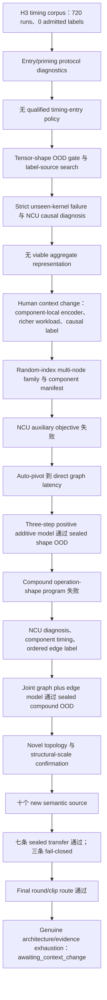
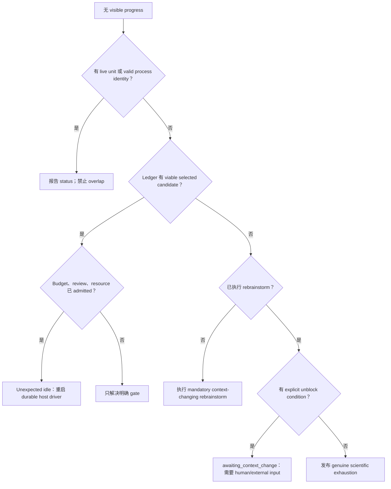

# Accorde H3 Autoresearch 复盘：进展、停止、自动转向、人工干预与框架改进（中文）

日期：2026-10-15

范围：为期八天的 Accorde H3/shape-OOD 研究，以及同步演进的 `autoresearch` runtime。

目的：为未来用户与 agent 提供教程，复盘有效与失败之处，并改进后续 human–autoresearch interaction。

---

## 中文

### 1. 执行摘要

用户观察到的总体情况最能描述这次体验：

- 8 天内大约探索了 **137 个研究方向**；
- 有 **10+ 次人工干预**，其中相当一部分——很可能远多于两三次——改变了
  科学目标、证据来源、模型架构或 pivot 方向；
- 其余不少干预是在恢复一个看起来“无故停机”的 loop；
- 最近一次持续探索约 **36 小时、59 个方向**。

核心结论既积极又有警示意义：

1. **科学 auto-pivot 已经较强。** campaign 得到 valid negative result 后，系统
   经常能在不放松 gate 的情况下切换 label、representation 或 objective。36 小时
   episode 证明长链 autonomous research 是可行的。
2. **程序安全已经较强。** immutable campaign identity、exact budget、failure-
   inclusive accounting、fresh recovery identity、prediction freeze、resource lease
   和 fail-closed verifier 阻止了很多 silent evidence corruption。
3. **liveness 弱于 scientific reasoning。** runtime 执行 declared work，但明确
   不启动 LLM，也不拥有 durable outer research agent。host agent turn、session-only
   schedule 或 controller 结束后，即使 ledger 仍有合法 next action，研究也可能
   看起来停止。
4. **人工干预不只是“继续”按钮。** 干预包括 impact-derived gate、把 tensor-
   shape OOD 设置为当前目标、结合 operation 与 shape、使用 NCU stall reason、
   要求 fundamentally different label/model objective，以及选择 component-local
   encoder / richer workload / causal label 方向。
5. **framework fix 降低了重复故障，但尚未补齐 orchestration gap。** runtime
   0.1.0–0.5.6 增加了 durability、review、confirmation isolation、goal steering、
   reorientation、rebrainstorm、recovery、accounting 和 `awaiting_context_change`。
   仍缺少的是一个 durable meta-controller：它能在合法 state transition 上持续
   唤醒 research agent，并把 unexpected idle 显式标记出来。

最重要的教学结论是：

> `autoresearch` 是 durable execution 与 decision-control substrate，不是完整的
> autonomous researcher。科学进展来自 runtime invariant、持续工作的 host agent
> 与 human context change 的组合。三者责任没有区分时，stop 就会显得莫名其妙。

### 2. 计数说明：“方向”还不是 first-class runtime object

用户计数与 machine ledger 计数的是不同对象，不能强行合并。

| 视角 | 数量 | 含义 |
|---|---:|---|
| 用户观察的研究方向 | 8 天约 137 | 用户语义上认为不同的 idea/route |
| 最近持续 episode | 约 36 小时 59 | 用户对最后长程探索的分组 |
| 最新 Overview r82 | 57 efforts | publication 时整理后的 effort narrative |
| state file | 193 campaigns | design、pilot、acquisition、model、confirmation、recovery、publication campaign |
| goal ledger | 229 checkpoints | terminal campaign outcome，比“方向”更细 |
| checkpoint outcomes | 136 supported、54 unsupported、38 invalid、1 inconclusive | 程序/科学 outcome，不是 unique idea |
| goal ledger records | 971 | goal、proposal、assessment、checkpoint、reorientation、recovery、control |
| reorientation/rebrainstorm candidates | 291 entries、283 unique IDs | 包括未执行 alternative |
| recovery records | 27 | procedural invalidity 的 authorized replacement |
| continuation artifacts | 11 | final phase 的 schedule/driver refresh，不等于完整人工干预数 |

durable goal ledger 只覆盖约 65.7 小时：2026-10-12 23:39 UTC 到
2026-10-15 17:21 UTC，因此无法重建完整 8 天。r82 的 57 个 published effort 与
用户观察的 59 个方向接近，但 grouping rule 不同。

**改进建议：**增加 immutable `research_direction_id`、`research_episode_id` 与
`human_intervention` record。一个 direction 可以包含多个 campaign/recovery。
届时 runtime 可以无歧义地报告：“59 directions、84 campaigns、9 recoveries、
3 human scientific pivots”。

### 3. 系统角色：autonomy 实际位于哪里

| 组件 | 负责 | 不负责 |
|---|---|---|
| `autoresearch` runtime | immutable contract、queue、receipt、lease、review store、goal ledger、admission、accounting | 生成科学 idea 或启动 LLM |
| Accorde adapter/controller | scientific campaign 定义、verifier、evidence interpretation、measurement/model code | 跨 session 的 persistent agent scheduling |
| Host agent / scheduled task | 读取 state、提出 pivot、创建 controller、发布 review、继续 loop | durable always-on service guarantee |
| Human | goal change、authority、technical hint、budget policy、review expectation、final stop/context | routine campaign execution |

runtime README 明确说明它“does not launch an LLM”。这个安全设计是合理的，但它
意味着 queue 完成不等于 research loop 会继续。必须由 host callback 或 durable
agent driver 把 checkpoint 连接到下一次 reorientation/proposal/assessment/launch。

### 4. 研究进程



#### 4.1 阶段 A：timing protocol diagnosis

起点 H3 corpus 已有 720 runs，但 formal label 为 0。主要问题是 measurement
entry stability，而不是 model capacity。自动探索包括 phase-order/priming、legacy
entry、entry factorial、query-free priming、window length、host affinity、per-phase
priming 和 idle transition。

系统正确保留了 negative result，没有 relabel old corpus，也没有放松 1% gate。
科学上这是正确的，但在确认整个 label-protocol family exhausted 前耗时较长。

#### 4.2 阶段 B：tensor-shape OOD 与 independent label source

loop 从 timing-entry tweak 转向 tensor-shape OOD gate 与 label stability，测试了
CUDA-event、wide-shape、Q100 与 Nsight route。这里形成了关键区别：

- valid scientific nonsupport 应触发新方向；
- procedural invalidity 应使用一个 corrected fresh identity；
- 两者都不意味着 parent goal 完成。

Nsight TMPDIR 问题通过 `/tmp/cliu/nvidia` 修复；随后 CUDA graph-node activity
在 event window 失败的场景中成为可靠 development label source。

#### 4.3 阶段 C：strict unseen-kernel failure 与 causal diagnosis

strict held-out-kernel 测试大幅失败。loop 检查 analytical baseline、support mask、
axis invariance、NCU stall cause、memory dependency、placement/reuse descriptor 与
physics-normalized objective。部分 descriptor 改善 error，但远未达到 direct 5%。

关键 auto-pivot 是从“增加 scalar feature”转向“representation 混淆了 local
composition”。simple random-access bridge 也失败，形成第一个 genuine
architecture boundary。

#### 4.4 阶段 D：human-supplied context change

此时人工 steering 是实质性科学贡献，包括：

- identity-invariant component-local tensor-access/set/graph encoder；
- richer multi-node non-embedding workload family；
- another serving-compatible causal label source。

这不是简单 forced continuation，而是改变 architecture、evidence population 与
label objective。后续构建了 exact component manifest、random-index multi-gather、
balanced shape/composition panel 和 invariant trainable encoder。

#### 4.5 阶段 E：auxiliary objective 失败后 direct latency 成功

component-local NCU objective 仍未通过 magnitude gate。loop 随后改变 endpoint，
而不是只增加 capacity：

- pooled direct model：median 尚可，但 family/tail 失败；
- positive node-sum：改善但仍失败；
- three shared dependency-message steps：development 全 gate 通过；
- sealed prediction-before-timing：MdAPE 2.6817%、p95 4.4614%。

这是良好 autonomous scientific pivot：保留 representation，放弃不合适 indirect
label，直接测试 endpoint，且没有 target calibration。

#### 4.6 阶段 F：compound failure 到 joint graph-edge success

fresh compound program 首次结果为 MdAPE 9.3838%。自动链随后探索 no-fit residual、
matched NCU、isolated component timing、higher-resolution event、25 个 ordered
operation-kind transition、三种 edge model、risk gate，最后采用 joint whole-graph
+ edge objective。

三个 edge-only model family 分别通过 21/25、22/25、22/25 pair gate，aggregate
success 没有覆盖 pair failure。joint objective 最终在 untouched compound 上达到
MdAPE 1.9899%、p95 4.8765%、family 8/8、quality 16/16。

#### 4.7 阶段 G：topology、scale 与 semantic breadth

loop 没有在第一次成功后停止：

- genuinely unseen topology family 通过；
- 15–20-node structural scale 通过；
- 十个 new semantic 完成 source qualification；
- affine scan、embedding-bag、weighted stencil、indexed accumulation、segmented
  reduction、gated nonlinear、scaled round/clip 通过 sealed transfer；
- causal softmax、row variance、row top-k 在 correctness/label completeness 上
  fail-closed，没有 promotion。

final state 不是旧 budget boundary。mandatory reorientation/rebrainstorm 在仍有
481.658760 秒时发现没有 complete untouched route，进入
`awaiting_context_change`。

### 5. Automatic pivot 做得好的地方

成功 auto-pivot 有五个共同点：

1. 对具体 failed gate 作出反应；
2. 一次只改变一个 scientific axis；
3. 保留 failure，不 filter invalid/unsupported row；
4. pilot-before-scale，并在 launch 前冻结 >2× budget；
5. prediction-before-timing，timing 后不 refit。

典型强例子：NCU auxiliary failure → direct latency；one-step additive → three-step
message；compound failure → ordered-edge label；edge-only failure → joint objective；
local topology failure → global descriptor；unstable event label → Nsight graph-node；
row-reduction semantic failure → spatial locality/indexed accumulation。

### 6. Stop taxonomy 与诊断

并非所有 stop 都错误；问题是不同 stop 对人看起来相似。

| Stop 类型 | 例子 | 停止是否正确 | 正确响应 |
|---|---|---|---|
| Scientific nonsupport | model miss family/p95 gate | 停该 route，继续 parent goal | automatic reorientation |
| Procedural invalidity | bad field、serializer、timeout、TMPDIR、incomplete result | 停 immutable campaign，不停 science | one fresh bounded recovery |
| Budget/review boundary | complete route 不 fit 或 goal review required | authority 明确前 hold launch | standing policy 或一次 human approval |
| No viable candidate | 当前 architecture/evidence slate exhausted | 进行一次 context-changing rebrainstorm | 若仍无，则等 human/external context |
| Awaiting context change | 无 new package/environment/authority | 正确 stop | 等待，不空转 |
| Host orchestration idle | queue settled/agent turn ended，但 next action 合法 | 不正确，是 liveness failure | durable driver 自动恢复 |
| Session schedule loss | session-only cron 消失、仅 idle fire、被替换 | 除 explicit stop 外不正确 | durable scheduler/heartbeat |
| Genuine exhaustion | final rebrainstorm 无 untouched route | 正确 | closeout + cancel schedule |

#### 6.1 为什么会“无故停机”

主要原因不是单个 bug，而是责任缺口：

1. `autoresearch` 合法完成 declared task 后变 idle；
2. goal ledger 要求 project-authored reorientation、candidate inventory、proposal、
   assessment；
3. runtime 有意不运行 LLM 来生成这些记录；
4. Trae host turn 或 session-only schedule 必须再次唤醒并创建 next record；
5. host turn 结束时，即使 standing intent 是 “auto”，UI 仍可能显示 stopped/waiting。

保守 state 进一步放大这种体验：`goal_review_required`、早期
`no_viable_candidate`、后来 `awaiting_context_change`、stale process identity、
pinned runtime version 都可能合法 hold 工作。因此不少人工“continue”没有提供
新科学内容，只是在恢复缺失的 durable host-agent activation。

### 7. 人工干预：更准确的分类

技术方向干预很可能远多于两三次。

#### 7.1 Scientific objective/gate/scope 干预

| Human direction | 效果 |
|---|---|
| unseen-kernel end gate MdAPE ≤5%，intermediate gate 根据 endpoint impact 设置 | 防止 arbitrary threshold 与 aggregate-only promotion |
| promote operation OOD，tensor-shape OOD 成为 active goal | 改变 parent claim |
| “combine operation and shape” | 创建 joint operation-shape program |
| MdAPE 很大时使用 NCU stall reason | 打开 causal diagnosis branch |
| stuck 时 brainstorm fundamentally different label/model objective | 防止 local retry loop |
| component-local encoder、richer multi-node workload、causal label source | 提供决定性 architecture/evidence context change |
| 第一次 model success 后继续 topology、scale、new semantics | 扩大 validity boundary |

这些都是真实 scientific intervention，不是简单 restart。

#### 7.2 Authority 与 budget 干预

包括 “auto please” / “keep it auto” / “continue auto research”、授权 launch new
non-blocked experiment、complete route >2× estimate、one-shot procedural recovery、
只因 scientific exhaustion 而 stop。它们本应一次编码成 durable policy；重复出现
说明 free-text intent 没有完全编译成 machine state。

#### 7.3 Infrastructure 干预

包括 `/tmp/cliu/nvidia`、fresh identity repair、finite/null metric、UI 中显示
`awaiting_context_change`、bilingual newcomer review、effort index 与 rendered
Markdown。

#### 7.4 Framework/meta-loop 干预

包括 every terminal checkpoint 后必须 reorient、no viable 后必须 rebrainstorm、
rebrainstorm 必须有 real context change、recovery extension 跨 goal revision 保留、
scientific unsupported 与 procedural invalidity 分开。

结论不应是“人工干预代表失败”。若干干预提供了系统无法自行推断的关键 context。
真正问题是：**scientific steering、authority、infrastructure repair 与 mere liveness
restart 都通过相似 free-text message 进入系统**，因此难以统计和诊断。

### 8. 对 `autoresearch` 的修复

#### 8.1 Runtime release progression

| Runtime | Commit | 修复 | 交互意义 |
|---|---|---|---|
| 0.1.0 | `d4ddee2` | durable queue、SQLite、receipt、lease、review inbox | controller loss 后 execution 可恢复 |
| 0.1.1 | `db4aa83` | migrated inbox 无 contract 也可 review | historical evidence 可检查 |
| 0.2.0 | `c5a33fc` | frozen-checkout confirmation + exposure ledger | prediction/confirmation separation 可 enforce |
| 0.3.0 | `9285f6e` | newcomer overview + effort history | human 可理解 research arc |
| 0.3.1 | `89f504d` | display-only 中文 | bilingual review 不改变 evidence/authority |
| 0.4.0 | `6c23271` | goal-linked proposal/assessment、aggregate admission、complete budget | local study 不会静默替代 parent goal |
| 0.4.1 | `a3f35b1` | contextual narrative | report 解释 before/after/why |
| 0.4.2 | `4b8c22e` | safe rendered Markdown | evidence 可读且不执行内容 |
| 0.5.0 | `905c852` | terminal study 后 mandatory reorientation | failed route 不等于 research end |
| 0.5.1 | `081b654` | narrative → effort cross-reference | reasoning 可审计 |
| 0.5.2 | `34660c6` | rebrainstorm + `awaiting_context_change` | 防 premature terminal 与 unchanged loop |
| 0.5.3 | `bbb7868` | authorized one-shot procedural recovery | correctable procedure 不再要求 scientific stop |
| 0.5.4 | `a2cc1d3` | goal revision 保留 recovery extension | scope change 不丢失/重复 budget |
| 0.5.5 | `2f43ebc` | evidence review 排在 effort history 前 | 先 evidence 后 narrative |
| 0.5.6 | `4482fda` | UI first-class `awaiting_context_change` | legitimate wait 不再只是 generic stopped |

#### 8.2 Accorde adapter/controller 修复

- Nsight TMPDIR 固定为 `/tmp/cliu/nvidia`；
- `profiler`/`nsys` freeze key 绑定同一 executable；
- profiling 前 correctness preflight；
- catch exception 且 always emit complete result；
- unavailable metric 使用 finite/null，禁止 Infinity；
- verifier policy validity 与 controller scientific classification 分离；
- invalid trace/row 永不复用；
- recovery 使用 fresh immutable identity；
- launch 前检查 PID/process identity/reservation/lease，防 overlap；
- SHA-256 freeze source/interpreter/input closure；
- prediction-before-timing + per-prediction hash；
- scientific runtime pin 与 newer review-only runtime 分离。

这些 pattern 应上升为 generic runtime helper，而不是每个 adapter 重写。

### 9. Case studies

#### 9.1 No viable architecture → human context change → direct model success

aggregate memory-proxy family exhausted 后，runtime 正确进入 no-viable，再记录
explicit unblock condition。human 提供 component-local representation、richer
workload、causal label。NCU objective 仍失败，但基础设施使 direct-latency pivot
成功。

**Lesson：** `awaiting_context_change` 是正确的。只有 forced continuation 会重复
failure；有价值的是改变 context。

#### 9.2 Compound failure → long auto-pivot → success

first compound model 失败后，loop 自动经过 NCU、component timing、transition
label、three edge models、risk gate，最终 joint graph+edge 成功。

**Lesson：**这是 autonomous research 的最佳例子；需要 durable outer driver，
但链内很少需要 human scientific input。

#### 9.3 Causal softmax invalidity → finite recovery → valid nonsupport

first acquisition 同时有 kernel/oracle mismatch 与 Infinity serialization，未产生
complete result。fresh corrected campaign 对 8 case 都记录 finite/null metric，最终
得到 valid 6/8 correctness nonsupport 并关闭 route。

**Lesson：**procedural recovery 的目标是恢复“可做决定”，不是保证 scientific
result supported。

#### 9.4 36 小时、59 方向 episode

该 episode 从 component architecture 走到 direct latency、compound interaction、
topology、structural scale 与 semantic breadth。r82 overview 整理出 57 effort，
与用户观察的 59 direction 接近。最终只在 mandatory no-viable rebrainstorm 且仍有
budget 时停止。

**Lesson：**standing authority、scheduled activation、recovery policy 与 clear gate
同时存在时，loop 可以长时间高质量运行。

### 10. 下一次交互的改进

#### P0：liveness 与 semantics

1. **Durable meta-controller：**订阅 ledger transition，自动调用 host research
   agent 完成 `checkpoint → reorientation → proposal → assessment → launch`。
2. **新增 `unexpected_idle`：**goal 未 stop、selected candidate viable、无 active
   campaign 且超过 grace period 时，标记 operational failure。
3. **机器可读且互斥的 stop reason：**`scientific_exhaustion`、
   `awaiting_context_change`、`awaiting_review`、`awaiting_budget_authority`、
   `procedural_recovery_ready`、`resource_busy`、`host_driver_missing`、
   `explicit_user_stop`。
4. **First-class direction/intervention record：**区分 science、authority、budget、
   infrastructure、UI 与 liveness resume。
5. **标准 result envelope：**case accounting、exception、finite/null metric、
   scientific support field 由 runtime helper 统一提供。

#### P1：authority、review 与 scheduling

6. standing authority 一次编码成 policy，避免重复 “continue auto research”；
7. durable scheduler 取代 session-only cron；
8. independent reviewer receipt 成为可审计 state；
9. 自动区分 live child、stale PID、external GPU use、unresolved reservation；
10. UI 明确 scientific runtime 与 review runtime 版本及各自职责。

#### P2：measurement 与 learning

11. 报告 direction-level productivity，而非只有 campaign count；
12. 统计每次 human scientific intervention 带来的 downstream autonomous
    direction 数；
13. 检测 retry-family saturation，区分 capacity tweak 与 representation/label/
    objective/evidence change；
14. 保留 direct endpoint、prediction-before-timing、subgroup/tail gate、invalid
    non-reuse 与 scoped promotion。

### 11. 推荐的 future human–agent protocol

#### 11.1 Episode 开始时一次性发布 policy

```yaml
goal: <scientific endpoint>
success_gate: <aggregate + subgroup + tail + coverage>
non_goals: <explicit exclusions>
automatic_authority:
  new_campaigns: true
  procedural_recovery_attempts_per_invalid_checkpoint: 1
  budget_extension: exact_minimum_for_complete_route_above_2x_estimate
  overlap: forbidden
stop_only_for:
  - explicit_user_stop
  - unresolved_safety_or_external_blocker
  - genuine_scientific_exhaustion_after_reorientation_and_rebrainstorm
review_triggers:
  - design_freeze
  - result_reduction
  - confirmation_readiness
```

#### 11.2 使用 typed human intervention

- `RESUME_LIVENESS`：无 scientific change，只重启 durable host driver；
- `CHANGE_GOAL`：改变 endpoint/scope，需要 goal revision；
- `SCIENTIFIC_HINT`：增加 hypothesis/candidate，但不强制 select；
- `INFRASTRUCTURE_FIX`：只改变 execution environment；invalid output 时必须 fresh
  identity；
- `BUDGET_AUTHORITY`：改变 cap/extension policy；
- `STOP`：durable explicit stop。

这样才能准确报告：“12 次人工干预：4 scientific、2 infrastructure、1 budget、
5 liveness resume”。

#### 11.3 Loop 停止时应问什么

不要先说“continue”，先要求 stop packet：exact ledger state、live process/lease、
blocker 分类、是否已有 viable candidate、缺少何种 authority/context、resume 是否会
reuse invalid evidence 或 overlap。



### 12. 教学总结

1. **Autonomy 是系统属性。** 好 prompt 不能替代 durable driver；durable queue 也
   不能自己发明科学 idea。
2. **Negative result 只有在 outer loop 存活时才是进展。**
3. **正确 stop 与继续同样重要。** `awaiting_context_change` 防止重复改名；还需要
   `unexpected_idle` 区分 dead host loop。
4. **Human guidance 应 typed。** scientific insight 与“请唤醒”不应在 ledger 中
   长得一样。
5. **Scope discipline 促成最终成功。** gate、hash、environment、data role 与
   failure 一直保持 binding。
6. **最佳 auto-pivot 跟随 evidence，而不是追求 novelty。**
7. **Review UX 很重要。** bilingual overview、rendered Markdown、effort link、
   ranked symptom 让人能在 architecture boundary 干预，而不是 micromanage。

### 13. Evidence 与 provenance

Autoresearch：

- `runtime/README.md`
- `runtime/docs/goal-steering.md`
- `runtime/docs/20261013-outer-loop-reorientation-plan.md`
- `runtime/docs/20261013-rebrainstorm-plan.md`
- `runtime/docs/20261013-procedural-recovery-plan.md`
- `runtime/docs/20261013-goal-revision-recovery-accounting-plan.md`
- Git commits `d4ddee2`–`4482fda`

Accorde：

- `local_artifacts/autoresearch/h3-autonomous-loop-v1/state.json`
- `local_artifacts/autoresearch/h3-autonomous-loop-v1/goal-steering/goals.sqlite3`
- `.plan/20261015-0205-plan-fresh-compound-program-identity-design.md`
- `reports/ppp_ir_mlp/roadmap_b_native_contraction_gather_v1/h3_autonomous_loop_v1/tensor-shape-goal-overview-r82.json`
- `reports/ppp_ir_mlp/roadmap_b_native_contraction_gather_v1/h3_autonomous_loop_v1/OVERVIEW-r82.md`

标为 user-observed 的方向/干预数量由用户提供；ledger count 为 machine-derived，
但 counting unit 不同。

---

## User observations and requests, verbatim

```text
summarize and diagnose the progression, stops, auto-pivots, human intervention (forced continuation and pivots) in using autoresearch, and the fixes to autoresearch, in a markdown in ~/wk/autoresearch/, the goal is to tutor, to reflect and to imporove future interactions.
```

```text
autoresearch在8天里面探索了137个方向，人工干预10+多次，有两三次是提供技术方向的支持和转向。剩余的主要是在解决无故停机问题。最近的一次比较长程的探索是36个小时，59个方向。
```

```text
maybe (much) more than 2-3 times...
```

```text
in both english and chinese.
```

```text
split the en and cn versions
```

```text
mv the two docs in ~/wk/autoresearch/runtime/docs, rename the files into lower case. and commit
```

## Revision History

| Revision | Timestamp | Change |
|---|---|---|
| r1 | 2026-10-15 14:27 -0700 | Created the full English/Chinese retrospective, reconciled user-observed and machine-ledger counts, diagnosed scientific/procedural/orchestration stops, documented runtime and adapter fixes, and proposed a future interaction protocol. |
| r2 | 2026-10-15 14:33 -0700 | Split the bilingual retrospective into standalone English and Chinese documents. |
| r3 | 2026-10-15 14:36 -0700 | Moved the standalone reports into `runtime/docs/` with lowercase filenames. |
