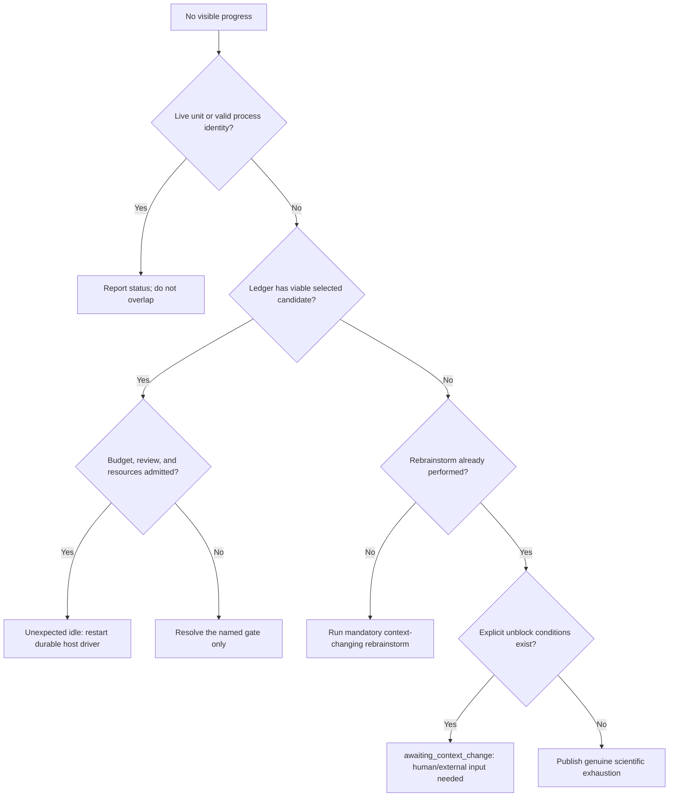

# Accorde H3 Autoresearch Retrospective: Progress, Stops, Pivots, Human Steering, and Framework Improvements (English)

Date: 2026-10-15

Scope: the eight-day Accorde H3/shape-OOD research episode and the accompanying evolution of the `autoresearch` runtime.

Purpose: tutor future users and agents, reflect on what worked and failed, and improve future human–autoresearch interaction.

---

## English

### 1. Executive summary

The user-observed top line is the best description of the experience:

- roughly **137 research directions in eight days**;
- **10+ human interventions**, with a substantial—not merely two or three—subset changing scientific goals, evidence sources, model architecture, or pivot direction;
- many of the remaining interventions were attempts to restart an apparently stopped loop;
- the latest sustained episode ran for roughly **36 hours and explored 59 directions**.

The central conclusion is mixed but encouraging:

1. **Scientific auto-pivoting became strong.** Once a campaign produced a valid
   negative result, the system often moved to a materially different label,
   representation, or objective without relaxing gates. The 36-hour episode is
   evidence that long autonomous chains were possible.
2. **Procedural safety became strong.** Immutable campaign identities, exact
   budgets, failure-inclusive accounting, fresh recovery identities, prediction
   freezing, resource leases, and fail-closed verification prevented many forms
   of silent evidence corruption.
3. **Liveness remained weaker than scientific reasoning.** The runtime executes
   declared work but explicitly does not launch an LLM or own a durable outer
   research agent. When the host agent turn, session-only schedule, or selected
   controller ended, research could appear to stop even though the goal ledger
   had a legal next action.
4. **Human interventions were not just “continue” clicks.** They included
   essential scientific changes: impact-derived gates, making tensor-shape OOD
   the active goal, combining operation and shape, using NCU stall reasons,
   demanding fundamentally different label/model objectives, and selecting a
   component-local encoder/richer workload/causal-label direction.
5. **The framework fixes reduced repeated failure modes but did not yet close
   the orchestration gap.** Runtime 0.1.0 through 0.5.6 added durability, review,
   confirmation isolation, goal steering, reorientation, rebrainstorming,
   recovery, accounting, and `awaiting_context_change`. What is still missing is
   a durable meta-controller that continuously invokes the research agent at
   legal state transitions and makes unexpected idleness explicit.

The most important tutoring lesson is:

> `autoresearch` was a durable execution and decision-control substrate, not a
> complete autonomous researcher. Scientific progress came from the combination
> of runtime invariants, an active host agent, and human context changes. Stops
> were confusing whenever those three responsibilities were not distinguished.

### 2. Counting caveat: “direction” is not yet a first-class runtime object

The user's count and the machine ledger count different things. They should not
be forced into one number.

| View | Observed count | What it means |
|---|---:|---|
| Human-observed research directions | ~137 over eight days | Semantically distinct ideas or routes as experienced by the user |
| Latest sustained episode | 59 over ~36 hours | Human grouping of the long final exploration |
| Latest published Overview r82 | 57 efforts | Curated effort-level narrative at publication time |
| State file | 193 campaigns | Design, pilot, acquisition, model, confirmation, recovery, and publication campaigns |
| Goal ledger | 229 checkpoints | Terminal campaign outcomes; finer than “direction” |
| Checkpoint outcomes | 136 supported, 54 unsupported, 38 invalid, 1 inconclusive | Procedural/scientific outcome records, not unique ideas |
| Goal ledger records | 971 | Goals, proposals, assessments, checkpoints, reorientations, recoveries, controls |
| Reorientation/rebrainstorm candidates | 291 entries, 283 unique IDs | Candidate records, including alternatives never executed |
| Recovery records | 27 | Authorized replacements for procedural invalidity |
| Recorded continuation artifacts | 11 | Schedule/driver refreshes in the final phase, not a complete intervention count |

The durable goal ledger covers only approximately 65.7 hours—from
2026-10-12 23:39 UTC through 2026-10-15 17:21 UTC—so it cannot reconstruct all
eight days. The 57 published efforts being close to the user-observed 59 in the
latest 36-hour episode is useful corroboration, but the grouping rules differ.

**Improvement:** add immutable first-class `research_direction_id`,
`research_episode_id`, and `human_intervention` records. A direction should own
many campaigns and recoveries. Then the runtime can report “59 directions, 84
campaigns, 9 recoveries, 3 human scientific pivots” without ambiguity.

### 3. System roles: where autonomy actually lived

Four components participated:

| Component | What it owned | What it did not own |
|---|---|---|
| `autoresearch` runtime | Immutable contracts, queue, receipts, leases, review store, goal ledger, admission, accounting | Generating scientific ideas or launching an LLM |
| Accorde project adapter/controllers | Scientific campaign definitions, verifiers, evidence interpretation, model/measurement code | Persistent agent scheduling across sessions |
| Host agent / scheduled task | Reading state, proposing pivots, creating controllers, publishing reviews, continuing the loop | A durable always-on service guarantee |
| Human | Goal changes, authority, technical hints, budget policy, review expectations, final stop/context changes | Routine campaign execution |

The runtime README is explicit: it “does not launch an LLM.” This design is
sound for safety, but it means that a completed queue is not the same thing as a
continuing research loop. A host callback or durable agent driver must bridge
each checkpoint to the next reorientation/proposal/assessment/launch.

### 4. Progression of the research

```mermaid
flowchart TD
  A[H3 timing corpus: 720 runs, 0 admitted labels] --> B[Entry/priming protocol diagnostics]
  B --> C[No qualified timing-entry policy]
  C --> D[Tensor-shape OOD gate and label-source search]
  D --> E[Strict unseen-kernel failure and NCU causal diagnosis]
  E --> F[No viable aggregate representation]
  F --> G[Human context change: component-local encoder, richer workload, causal label]
  G --> H[Random-index multi-node family and component manifests]
  H --> I[NCU auxiliary objective fails]
  I --> J[Auto-pivot to direct graph latency]
  J --> K[Three-step positive additive model passes sealed shape OOD]
  K --> L[Compound operation-shape programs fail]
  L --> M[NCU diagnosis, component timing, ordered edge labels]
  M --> N[Joint graph plus edge model passes sealed compound OOD]
  N --> O[Novel topology and structural-scale confirmation]
  O --> P[Ten new semantic sources]
  P --> Q[Seven sealed transfers pass; three close fail-closed]
  Q --> R[Final round/clip route passes]
  R --> S[Genuine architecture/evidence exhaustion: awaiting_context_change]
```



#### 4.1 Phase A: timing-protocol diagnosis

The starting H3 corpus had collected 720 runs but admitted zero formal labels.
The immediate problem was measurement entry stability, not model capacity.
Automatic work explored:

- phase-order and priming;
- legacy entry reproduction;
- a full entry factorial;
- query-free priming and one recovery;
- longer windows;
- host affinity;
- per-phase priming;
- idle transitions.

The system correctly retained negative results. It did not relabel the old
corpus or relax the 1% gate. This was scientifically disciplined, but it also
consumed long stretches before establishing that the label protocol family was
exhausted.

#### 4.2 Phase B: tensor-shape OOD and independent label sources

The loop moved from timing-entry tweaks toward tensor-shape OOD gates and label
stability. CUDA-event, wide-shape, Q100, and Nsight routes were tested. This
period revealed a recurring distinction:

- **valid scientific nonsupport** should trigger a new direction;
- **procedural invalidity** should trigger one corrected fresh identity;
- neither should be described as goal completion.

The temporary-directory failure in Nsight was repaired with
`/tmp/cliu/nvidia`. Later, CUDA graph-node activity became a reliable
development label source where event windows had failed.

#### 4.3 Phase C: strict unseen-kernel failure and causal diagnosis

Strict held-out-kernel tests failed badly. The loop examined analytical
baselines, support masks, axis invariance, NCU stall causes, memory dependency,
placement/reuse descriptors, and physics-normalized objectives. Several
descriptors improved error but did not approach the direct 5% endpoint.

The important auto-pivot was from “add more scalar features” to “the
representation aliases local composition.” A simple random-access bridge also
failed, producing the first genuine architecture boundary.

#### 4.4 Phase D: human-supplied context change

At this boundary, human steering was scientifically substantive. The proposed
new context included:

- an identity-invariant component-local tensor-access/set/graph encoder;
- a richer multi-node non-embedding workload family;
- another serving-compatible causal label source.

This was not merely forced continuation. It changed the architecture, evidence
population, and label objective. The resulting path built exact component
manifests, random-index multi-gather programs, balanced shape/composition
panels, and invariant trainable encoders.

#### 4.5 Phase E: direct latency succeeds after auxiliary objectives fail

The component-local NCU objective still failed its magnitude gates. The loop
then automatically changed the endpoint rather than adding capacity:

- pooled direct-latency model: acceptable median, failed family/tail gates;
- positive node-sum model: improved, still failed;
- three shared dependency-message steps: all development gates passed;
- sealed prediction-before-timing confirmation: MdAPE 2.6817%, p95 4.4614%.

This is an example of good autonomous scientific pivoting: the representation
was retained, the indirect label was abandoned, and the direct endpoint was
tested without target calibration.

#### 4.6 Phase F: compound operation-shape failure to joint graph-edge success

Fresh compound programs initially failed at MdAPE 9.3838%. The automatic chain
then explored:

- no-fit residual and matched NCU diagnosis;
- isolated component latency;
- higher-resolution event timing;
- all 25 ordered operation-kind transitions;
- additive typed-edge, directed-interaction, and factorized-role models;
- a cross-fitted admission-risk gate;
- finally, a joint whole-graph plus edge objective.

The first three edge-only model families failed 21/25, 22/25, and 22/25 pair
gates. Aggregate success did not override pair failures. The joint objective
then passed untouched compound confirmation at MdAPE 1.9899%, p95 4.8765%,
8/8 families, and 16/16 quality.

#### 4.7 Phase G: topology, scale, and semantic breadth

The loop continued beyond the first success:

- genuinely unseen topology families passed;
- 15–20-node structural scale passed;
- ten new semantics were source-qualified;
- affine scan, embedding-bag sum, weighted stencil, indexed accumulation,
  segmented reduction, gated nonlinear, and scaled round/clip passed sealed
  shape transfer;
- causal softmax, row variance, and row top-k closed on correctness or label
  completeness without model promotion.

The final state was not an old budget boundary. It was a mandatory
reorientation and rebrainstorm that found no complete untouched route without a
new mixed-semantic package, value-distribution descriptor, or external target.
The ledger entered `awaiting_context_change` with 481.658760 seconds remaining.

### 5. What automatic pivoting did well

The best automatic pivots shared five properties:

1. **They reacted to a specific failed gate.** Pooled latency failed tails and
   families, so the next model changed aggregation rather than widening the
   same MLP.
2. **They changed one scientific axis at a time.** Label source, representation,
   objective, topology coverage, or semantic coverage was changed with a frozen
   next checkpoint.
3. **They preserved failures.** Invalid or unsupported rows were not filtered
   away, and aggregate metrics did not override subgroup gates.
4. **They used pilot-before-scale.** Maximum-shape or fit-cost pilots preceded
   full panels and budgets were frozen above 2× conservative estimates.
5. **They separated prediction from timing.** Predictions and hashes preceded
   sealed timing, with no refit afterward.

Strong examples include:

- auxiliary NCU failure → direct CUDA-event latency;
- one-step additive failure → three shared message steps;
- compound failure → direct ordered-edge labels;
- edge-only failure → joint graph+edge objective;
- local topology failure → explicit global descriptors;
- unstable event label → Nsight graph-node duration;
- failed row-reduction semantics → spatial locality and indexed accumulation.

### 6. Stop taxonomy and diagnosis

Not every stop was wrong. The problem was that different stop causes looked
similar to the human.

| Stop class | Example | Was stopping correct? | Required response |
|---|---|---|---|
| Scientific nonsupport | Model misses family/p95 gate | Stop that route, continue parent goal | Automatic reorientation |
| Procedural invalidity | Bad field, serializer, timeout, TMPDIR, incomplete result | Stop that immutable campaign, not the science | One fresh bounded recovery |
| Budget/review boundary | Complete route does not fit or goal review required | Hold launch until authority is explicit | Standing policy or one human approval |
| No viable candidate | Existing architecture/evidence slate exhausted | Rebrainstorm once with a real context change | Human or external context if none exists |
| Awaiting context change | No new package/environment/authority exists | Yes; this is a real scientific boundary | Wait, do not spin |
| Host orchestration idle | Controller queue settles or agent turn ends although next action is legal | No; this is an operational liveness failure | Durable driver should resume automatically |
| Session schedule loss | Session-only cron disappears, fires only while idle, or is replaced | No, unless explicit stop | Durable scheduler/heartbeat |
| Genuine exhaustion | Final mandatory rebrainstorm finds no untouched route | Yes | Publish closeout and cancel schedule |

#### 6.1 Why “unexplained stops” happened

The main cause was a responsibility gap rather than one state-machine bug:

1. `autoresearch` ran declared tasks and then legally became idle.
2. The goal ledger required a project-authored reorientation, scientific
   candidate inventory, proposal, and assessment.
3. The runtime intentionally did not run an LLM to author those records.
4. A Trae host turn or session-only scheduled task had to wake up and create the
   next records.
5. If the host turn ended, the visible UI showed a stopped or waiting state even
   when standing user intent was “auto.”

Safety states amplified the perception:

- `goal_review_required` correctly prevented unreviewed budget/scope changes;
- `no_viable_candidate` originally looked terminal before rebrainstorm existed;
- `awaiting_context_change` correctly stops unchanged loops, but the UI support
  arrived later in runtime 0.5.6;
- a stale or unknown process identity correctly blocked overlapping work;
- pinned scientific runtimes could not be mutated in place to gain newer state
  behavior.

Thus many human “continue” interventions did not contribute new science. They
recreated the missing durable host-agent activation.

### 7. Human intervention: a more accurate classification

The technical-direction count is likely much more than two or three. A useful
classification is below.

#### 7.1 Scientific objective, gate, or scope interventions

| Human direction | Effect |
|---|---|
| Set the unseen-kernel end gate to MdAPE ≤5% and derive intermediate gates from endpoint impact | Prevented arbitrary thresholds and aggregate-only promotion |
| Promote operation OOD and make tensor-shape OOD the active goal | Changed the parent claim |
| “Can you combine operation and shape together?” | Created the joint operation-shape program |
| Use NCU stall reasons when MdAPE is huge | Opened a causal-diagnosis branch |
| Brainstorm fundamentally different reliable label sources or model objectives | Prevented local retry loops |
| Explore component-local encoder, richer multi-node workloads, and a causal label source | Supplied the decisive architecture/evidence context change |
| Continue beyond the first supported model into topology, structural scale, and new semantics | Expanded the validity boundary |

These are genuine scientific interventions, not just restarts.

#### 7.2 Authority and budget interventions

Examples include:

- “auto please” / “keep it auto” / “continue auto research”;
- authorization to launch any new non-blocked experiment;
- require a complete budget above 2× estimate before launch;
- standing authority for one fresh procedural recovery;
- stop only for scientific exhaustion, not correctable procedure or old budget.

These directions should have been encoded once as durable policy. Repeating
them indicates that free-text intent was not fully compiled into machine state.

#### 7.3 Infrastructure interventions

- use `/tmp/cliu/nvidia` for Nsight temporary files;
- fix the issue and continue under a fresh identity;
- require finite/null failure metrics rather than Infinity;
- expose `awaiting_context_change` in the UI;
- keep the review inbox bilingual, newcomer-readable, and linked to effort
  indices.

#### 7.4 Framework/meta-loop interventions

- require reorientation after every terminal checkpoint;
- if no candidate is viable, rebrainstorm rather than terminate immediately;
- rebrainstorm must use a real context change, otherwise wait explicitly;
- preserve procedural recovery extensions across goal revisions;
- distinguish scientific unsupported outcomes from procedural invalidity.

The right conclusion is not “human intervention was a failure.” Several
interventions supplied exactly the context an autonomous system could not infer.
The failure was that **scientific steering, authority, infrastructure repair, and
mere liveness restart all arrived through similar free-text messages**, making
their frequency and necessity hard to diagnose.

### 8. Fixes made to `autoresearch`

#### 8.1 Runtime release progression

| Runtime | Commit | Fix | Interaction lesson |
|---|---|---|---|
| 0.1.0 | `d4ddee2` | Durable queue, SQLite store, worker receipts, leases, integrated review inbox | Execution can survive controller loss |
| 0.1.1 | `db4aa83` | Review migrated inboxes without a campaign contract | Historical evidence remains inspectable |
| 0.2.0 | `c5a33fc` | Frozen-checkout procedural confirmation and exposure ledger | Prediction/confirmation separation becomes enforceable |
| 0.3.0 | `9285f6e` | Newcomer-friendly workflow overview and effort history | Human can follow the research arc |
| 0.3.1 | `89f504d` | Simplified Chinese display-only translations | Bilingual review without changing evidence/authority |
| 0.4.0 | `6c23271` | Goal-linked proposal/assessment, aggregate admission, complete-route budget | Local studies cannot silently replace the parent goal |
| 0.4.1 | `a3f35b1` | Contextual evidence-backed narratives | Reports explain before/after/why, not only outcome |
| 0.4.2 | `4b8c22e` | Safe rendered Markdown evidence view | Review becomes readable without executing content |
| 0.5.0 | `905c852` | Mandatory outer-loop reorientation after terminal studies | A failed route no longer implies end of research |
| 0.5.1 | `081b654` | Narrative-to-effort cross references | Overview reasoning is auditable against attempts |
| 0.5.2 | `34660c6` | Context-changing rebrainstorm and `awaiting_context_change` | Prevents both premature terminal state and unchanged brainstorm loops |
| 0.5.3 | `bbb7868` | Authorized one-shot procedural recovery with fresh identity | Correctable procedure no longer requires scientific stop |
| 0.5.4 | `a2cc1d3` | Preserve recovery extensions across goal revisions | Scope change no longer erases or double-counts recovery budget |
| 0.5.5 | `2f43ebc` | Show evidence review before effort history | Review order emphasizes evidence before narrative |
| 0.5.6 | `4482fda` | Show `awaiting_context_change` as a first-class workflow state | The UI explains a legitimate wait rather than generic stopped state |

#### 8.2 Accorde-side adapter/controller fixes

Several fixes were project integration changes, not generic runtime releases:

- standardized writable Nsight TMPDIR at `/tmp/cliu/nvidia`;
- bound both `profiler` and `nsys` freeze keys to the same executable;
- preflighted correctness before profiling;
- caught correctness/profiler exceptions and always emitted a complete result;
- represented unavailable metrics as finite values or `null`, never Infinity;
- separated verifier policy/accounting validity from controller scientific
  classification;
- retained invalid traces and rows as non-reusable;
- used new immutable campaign identities for the one authorized recovery;
- checked PID, process identity, ledger reservation, and resource lease before
  launch to prevent overlapping controllers;
- froze source/interpreter/input closures by SHA-256;
- used prediction-before-timing campaigns with per-prediction hashes;
- maintained a separate newer review-only runtime while scientific campaigns
  remained pinned.

These patterns should be promoted into reusable runtime helpers. Reimplementing
finite failure envelopes and recovery classification in every project adapter
is error-prone.

### 9. Case studies

#### 9.1 No viable architecture → human context change → successful direct model

The aggregate memory-proxy family was exhausted. The runtime correctly reached
a no-viable slate, then rebrainstorming recorded explicit unblock conditions.
The human supplied component-local representation, richer workload, and causal
label directions. The NCU objective still failed, but the same infrastructure
enabled a direct-latency pivot that succeeded.

**Lesson:** `awaiting_context_change` was correct. Forced continuation alone
would have repeated failures; the valuable intervention changed the context.

#### 9.2 Compound failure → long automatic pivot chain → success

The first compound model failed. Without relaxing gates, the loop moved through
NCU diagnosis, direct component timing, transition labels, three edge models,
and a risk gate before the joint graph+edge objective passed.

**Lesson:** this is the best example of autonomous research. It required a
durable outer driver, but little human scientific input inside the chain.

#### 9.3 Causal softmax invalidity → finite recovery → valid nonsupport

The first acquisition mixed a kernel/oracle mismatch with Infinity
serialization failure, producing no complete result. The corrected fresh
campaign recorded all eight cases with finite/null metrics. It then established
a valid 6/8 correctness nonsupport and closed the route.

**Lesson:** procedural recovery should recover the ability to decide; it should
not force the scientific result to become supported.

#### 9.4 The 36-hour, 59-direction episode

The final long episode progressed from component architecture through direct
latency, compound interaction, topology, structural scale, and semantic breadth.
The published r82 overview consolidated 57 effort records, close to the
user-observed 59 directions. It ended only after a mandatory no-viable
rebrainstorm with budget remaining.

**Lesson:** the scientific loop can run long and productively when standing
authority, scheduled activation, recovery policy, and clear gates are all
simultaneously present.

### 10. Improvements for the next interaction

#### P0: liveness and semantics

1. **Add a durable meta-controller.** It should subscribe to ledger transitions
   and invoke a configured host research agent for:
   `checkpoint → reorientation → proposal → assessment → launch`. It must remain
   separate from scientific truth validation, but it must own liveness.
2. **Add `unexpected_idle`.** If no campaign is active, the goal is not stopped,
   a viable selected candidate exists, and no host action arrives within a
   grace period, expose an operational failure instead of “stopped.”
3. **Make stop reasons mutually exclusive and machine-readable:**
   `scientific_exhaustion`, `awaiting_context_change`, `awaiting_review`,
   `awaiting_budget_authority`, `procedural_recovery_ready`, `resource_busy`,
   `host_driver_missing`, `explicit_user_stop`.
4. **Create first-class direction and intervention records.** Track whether a
   human message changes science, authority, budget, infrastructure, UI, or only
   resumes liveness.
5. **Standardize a result envelope.** Every unit should emit case accounting,
   exception information, finite/null metrics, and scientific-support fields;
   the runtime should provide the helper and reject NaN/Infinity centrally.

#### P1: authority, review, and scheduling

6. **Compile standing authority into policy once.** Encode maximum automatic
   budget extension, one-shot procedural recovery, non-overlap, and scientific
   stop conditions. Do not require repeated “continue auto research.”
7. **Use a durable scheduler, not session-only cron.** Schedule identity,
   heartbeat, expiry, replacement, and cancellation should live in the runtime
   store and survive host sessions.
8. **Record independent reviewer receipts.** The original design called for
   automatic reviewers at design freeze, result reduction, and confirmation
   readiness. The inbox became strong, but reviewer participation should be an
   auditable state, not inferred from publication.
9. **Automatically reconcile stale PID/lease state.** Distinguish live child,
   stale driver metadata, external GPU use, and unresolved runtime reservation.
10. **Keep scientific and review runtime pins separate but visible.** The UI
    should show “scientific runtime 0.5.4; review runtime 0.5.6” and explain which
    state semantics are enforcement versus presentation.

#### P2: measurement and learning

11. **Report direction-level productivity:** supported, unsupported, invalid,
    recovered, and human-pivoted directions per hour—not only campaign counts.
12. **Measure intervention leverage:** how many downstream autonomous directions
    followed each human scientific intervention.
13. **Detect retry-family saturation:** show when multiple variants change only
    capacity or thresholds versus changing representation, label, objective, or
    evidence population.
14. **Preserve the successful scientific rules:** direct endpoint gates,
    prediction-before-timing, subgroup/tail gates, invalid-output non-reuse, and
    scope-limited promotion.

### 11. Recommended future human–agent protocol

#### 11.1 Start-of-episode contract

At the beginning, publish one durable policy with:

```yaml
goal: <scientific endpoint>
success_gate: <aggregate + subgroup + tail + coverage>
non_goals: <explicit exclusions>
automatic_authority:
  new_campaigns: true
  procedural_recovery_attempts_per_invalid_checkpoint: 1
  budget_extension: exact_minimum_for_complete_route_above_2x_estimate
  overlap: forbidden
stop_only_for:
  - explicit_user_stop
  - unresolved_safety_or_external_blocker
  - genuine_scientific_exhaustion_after_reorientation_and_rebrainstorm
review_triggers:
  - design_freeze
  - result_reduction
  - confirmation_readiness
```

#### 11.2 Human intervention format

Use typed interventions:

- `RESUME_LIVENESS`: no scientific change; restart the durable host driver.
- `CHANGE_GOAL`: changes endpoint or scope; requires a new goal revision.
- `SCIENTIFIC_HINT`: adds a hypothesis or candidate, but does not force
  selection.
- `INFRASTRUCTURE_FIX`: changes execution environment only; requires a fresh
  identity if prior output is invalid.
- `BUDGET_AUTHORITY`: changes aggregate cap or extension policy.
- `STOP`: durable explicit stop.

This would make it possible to say: “12 human interventions: 4 scientific, 2
infrastructure, 1 budget, 5 liveness resumes.”

#### 11.3 What to ask when the loop stops

Do not start with “continue.” Ask for a stop packet:

1. What is the exact ledger state?
2. Is a campaign/process/lease actually live?
3. Is the blocker scientific, procedural, budgetary, review, resource, or host
   liveness?
4. Is a viable selected candidate already bound?
5. What authority or context change is missing?
6. Would resuming reuse invalid evidence or overlap work?

Then issue the appropriate typed control.



### 12. Tutoring lessons

1. **Autonomy is a systems property.** A good agent prompt cannot compensate for
   a non-durable driver; a durable queue cannot invent scientific ideas.
2. **Negative results are progress only if the outer loop is alive.** The H3
   study preserved failures well, but early versions did not always guarantee a
   successor brainstorm.
3. **Correct stopping is as important as continuing.** `awaiting_context_change`
   prevents endless renaming of exhausted ideas; `unexpected_idle` is needed to
   distinguish that from a dead host loop.
4. **Human guidance should be typed.** Scientific insight and “please wake up”
   should not look the same in the ledger.
5. **Scope discipline enabled the final success.** The model became usable
   because gates, hashes, environment, data roles, and failures stayed binding.
6. **The best auto-pivots followed evidence, not novelty for its own sake.** They
   changed the missing axis while retaining useful infrastructure.
7. **Review UX matters.** Bilingual overviews, rendered Markdown, effort links,
   and ranked symptoms let the human intervene at architecture boundaries
   rather than micromanage every campaign.

### 13. Evidence and provenance

Primary runtime sources:

- `runtime/README.md`
- `runtime/docs/goal-steering.md`
- `runtime/docs/20261013-outer-loop-reorientation-plan.md`
- `runtime/docs/20261013-rebrainstorm-plan.md`
- `runtime/docs/20261013-procedural-recovery-plan.md`
- `runtime/docs/20261013-goal-revision-recovery-accounting-plan.md`
- Git commits `d4ddee2` through `4482fda`

Primary Accorde sources:

- `local_artifacts/autoresearch/h3-autonomous-loop-v1/state.json`
- `local_artifacts/autoresearch/h3-autonomous-loop-v1/goal-steering/goals.sqlite3`
- `.plan/20261015-0205-plan-fresh-compound-program-identity-design.md`
- `reports/ppp_ir_mlp/roadmap_b_native_contraction_gather_v1/h3_autonomous_loop_v1/tensor-shape-goal-overview-r82.json`
- `reports/ppp_ir_mlp/roadmap_b_native_contraction_gather_v1/h3_autonomous_loop_v1/OVERVIEW-r82.md`

The numeric direction/intervention totals labeled “user-observed” are supplied
by the user. Ledger counts are machine-derived but use different units.

---

## User observations and requests, verbatim

```text
summarize and diagnose the progression, stops, auto-pivots, human intervention (forced continuation and pivots) in using autoresearch, and the fixes to autoresearch, in a markdown in ~/wk/autoresearch/, the goal is to tutor, to reflect and to imporove future interactions.
```

```text
autoresearch在8天里面探索了137个方向，人工干预10+多次，有两三次是提供技术方向的支持和转向。剩余的主要是在解决无故停机问题。最近的一次比较长程的探索是36个小时，59个方向。
```

```text
maybe (much) more than 2-3 times...
```

```text
in both english and chinese.
```

```text
split the en and cn versions
```

```text
mv the two docs in ~/wk/autoresearch/runtime/docs, rename the files into lower case. and commit
```

## Revision History

| Revision | Timestamp | Change |
|---|---|---|
| r1 | 2026-10-15 14:27 -0700 | Created the full English/Chinese retrospective, reconciled user-observed and machine-ledger counts, diagnosed scientific/procedural/orchestration stops, documented runtime and adapter fixes, and proposed a future interaction protocol. |
| r2 | 2026-10-15 14:33 -0700 | Split the bilingual retrospective into standalone English and Chinese documents. |
| r3 | 2026-10-15 14:36 -0700 | Moved the standalone reports into `runtime/docs/` with lowercase filenames. |
